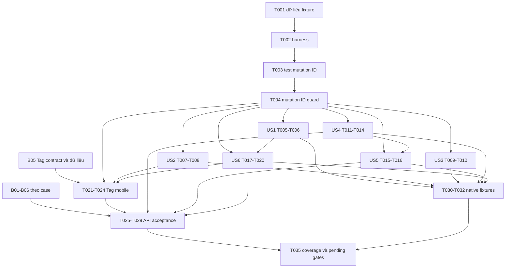

# Tasks — Learning Request mobile

Checkpoint 2026-10-11. Phạm vi user chốt: làm phần có thể tích hợp, thống nhất
field/UI, nối yêu cầu của tôi vào Hồ sơ và sửa Back form. Notification tách riêng.

- [x] Runtime API dùng HTTP/Auth chung, query cache theo user/session generation.
- [x] Parse projection owner/public, metadata phân trang; không fallback mock khi lỗi.
- [x] My Requests có lọc trạng thái, refresh, phân trang, loading/error/empty.
- [x] Form tạo/sửa dùng Skill UUID thật, learningGoal, currentLevel,
      verifiedTeacherOnly, preferredSlots và expiresAt theo contract.
- [x] PATCH chỉ field đổi + expectedVersion; giữ tagIds và timestamp không sửa.
- [x] Own detail có publish/cancel, confirmation hủy, moderation/reject reason và effectiveStatus.
- [x] Discovery dùng feed/recommended, keyword, skillId và phân trang API.
- [x] Search chuyển yêu cầu học vào Discovery; public detail đọc projection thật.
- [x] Profile shortcut; Back theo history và replace/dismiss editor sau lưu.
- [x] UI dùng layout/card/fields/error chung; lỗi 503 giữ form, 409/unknown outcome chặn lưu lại mù.
- [x] Chặn request thật đi vào Proposal/profile mock; link fixture dùng guest preview.
- [x] Unit/API fixture tests và kiểm tra web ở viewport điện thoại.
- [ ] Tag picker/filter: cần endpoint lookup canonical Tag IDs (GAP-02).
- [ ] Backend nối Catalog/public owner/Sharing Skill/lock readers và kiểm tra LR thật.
- [x] Public profile: Xem hồ sơ ở detail nối owner UUID tới API profile/skills;
      source, fixture navigation và denial/retry checked2026-10-13, API/native acceptance pending.
- [ ] Proposal thật: chờ contract của feature tương ứng.
- [ ] Android/iOS: keyboard, font lớn, hardware Back/gesture trong lúc pending.
- [ ] Nghiệm thu đầy đủ AC-01..16 sau khi dependencies sẵn sàng.

Shared mobile changes: HTTP client hỗ trợ lấy metadata tùy chọn (caller cũ giữ hành vi);
Auth runtime cung cấp chính client đã bind session; layout hỗ trợ callback Back và
khóa điều hướng khi pending. Header sửa điều kiện title rỗng gây text node lỗi trên web.
DataForm sửa generic Zod để typecheck với phiên bản đã cài, không đổi validation runtime.
ChoiceGroup thêm prop disabled tùy chọn để khóa lựa chọn bằng bàn phím khi form đang lưu.
Không sửa backend, không thêm dependency, chưa commit/push.

## Task bổ sung từ plan — 2026-10-12

Input: [plan](plan.md), [research](research.md), [data model](data-model.md),
[HTTP](contracts/http.md), [UI](contracts/ui.md), [quickstart](quickstart.md).
Các path dưới đây tương đối với `apps/mobile`; path mới là output dự kiến,
không phải bằng chứng file/feature đã tồn tại.

Checkpoint phía trên giữ nguyên: 12 mục hoàn thành và 5 mục pending tổng hợp.
Các task T001..T035 bên dưới chỉ chi tiết hóa phần còn thiếu; không tái triển khai
HTTP/Auth, CRUD, Profile shortcut hoặc Back đã có. Những mục pending tổng hợp
không được cộng lần nữa vào số task mới hoặc hiểu là lệnh sửa backend.
Tests có căn cứ từ yêu cầu kiểm tra trong spec/plan; chỉ bổ sung failure cases
chưa có evidence. Không tạo test chỉ để mirror style hoặc implementation.

### Tổng hợp phạm vi và trạng thái

| Nhóm task mới                       | Số lượng | Mã                     | Trạng thái trước triển khai                                            |
| ----------------------------------- | -------- | ---------------------- | ---------------------------------------------------------------------- |
| Mobile làm được bằng fixture/source | 23       | T001..T020, T033..T035 | Ready theo dependency task; không cần sửa API backend                  |
| Mobile Tag chờ contract             | 4        | T021..T024             | Blocked B05; nghiệm thu thật còn cần B01/B06                           |
| Nghiệm thu API thật                 | 5        | T025..T029             | Pending prerequisites theo bảng Bxx; không đồng nghĩa được sửa backend |
| Nghiệm thu/fix native               | 3        | T030..T032             | Pending Android/iOS device/build và evidence                           |

US labels `[US1]`..`[US6]` tương ứng US-01..US-06 trong spec. `[P]` chỉ là khả
năng làm song song khi prerequisites đã hoàn thành và file không xung đột;
không phải yêu cầu tự tạo agent. Backend Bxx bên dưới là gate, không phải task
implementation trong workspace mobile.

### Phase 1 — Setup phần kiểm thử còn thiếu

Goal: Thay fixture server tạm ngoài repo bằng harness test-only có thể chạy lại.
Không khởi tạo lại app, Spec Kit, Auth hoặc Git.

- [x] T001 Tạo dữ liệu fixture có schema owner/public đúng, UUID canonical, hai user giả và >=2 cursor pages trong `tests/fixtures/learning-requests-data.ts`; tạo timestamp tương lai theo test clock, không dùng tài khoản/data thật hoặc import fixture vào runtime app (M06).
- [x] T002 Tạo HTTP fixture server cô lập tại `tests/fixtures/learning-requests-api.ts` dùng dữ liệu T001, fake Auth/Skills, trạng thái conflict409/create503/unknown outcome/delayed response/expired GET/recommended snapshot đổi, detail có cache rồi GET404/403, network/503 và mutation403/429 cho account không ACTIVE/thiếu grant/policy hạn chế (fixture chỉ dựng response, không tính eligibility); ghi cách start/stop, URL/port4315 và Expo8082 trong `specs/005-learning-request/quickstart.md`; không sửa .env hoặc phát request sang API thật (M06).

Checkpoint: Harness chỉ dùng trong tests/dev process, có thể lặp failure scenarios
mà không bypass guard hoặc fallback mock trong feature.

### Phase 2 — Foundational: bảo vệ response targeted mutation

Goal: Ngăn response lỗi contract cập nhật request khác trước mọi story recovery.
MVP foundational này không yêu cầu Catalog backend đã hoạt động.

- [x] T003 Thêm regression wrong-resource ID cho PATCH/publish/cancel trong `tests/learning-requests-mutations.test.ts`: owner schema hợp lệ nhưng id khác target phải protocol failure; correct target và safe positive version vẫn hoạt động, không tự retry mutation hoặc nhận kết quả phiên cũ (M04).
- [x] T004 Kiểm response.id đúng target ID sau parse trong edit/action ở `src/features/learning-requests/api/requests-api.ts`, trước caller sync/toast/navigation; dùng AppError protocol chung, giữ behavior create/detail/Skill và kiểm T003 qua (M04; FR-29/30).

Dependency: T003/T004 sau T001..T002. Tests phải chứng minh failure cụ thể trước
fix; các test đã tồn tại không đổi trạng thái hoặc bị xóa.

### Phase 3 — US-01 Quản lý yêu cầu của tôi (P1)

Goal: Lỗi page sau không làm Mine giống initial failure hoặc mất bài đã tải.
Independent test: Mine có >=2 pages; trang sau lỗi, trang trước vẫn xem được,
footer có retry; refresh/filter/status không trộn dữ liệu phiên khác (AC-01/11).

- [x] T005 [US1] Kiểm Mine bằng harness T002 với next-page503/network và refresh trong khi load-more; ghi failure/current behavior và dataset vào `specs/005-learning-request/validation/fixtures.md`, giữ items/page đầu để xác định đúng phần cần sửa (M03/M06).
- [x] T006 [US1] Bổ sung phân biệt initial/refresh/next-page failure và footer retry cho `src/features/learning-requests/screens/my-requests-screen.tsx`; nếu cần UI chung tách `src/features/learning-requests/components/request-list-footer.tsx`, khóa fetchNextPage khi query.isFetching, giữ items đã tải và kiểm lại T005; không dùng count từ một page làm total (M03).

### Phase 4 — US-02 Tạo và lưu bản nháp (P1)

Goal: Input time còn hợp lệ lúc submit hoặc được báo lỗi theo field, giữ draft.
Independent test: Nhập time tương lai, giữ form mở qua deadline, submit không
crash/gửi slots undefined; fields untouched vẫn giữ timestamp server (AC-04/05).

- [x] T007 [P] [US2] Bổ sung delayed-submit/fake-clock tests tại `tests/learning-requests-time.test.ts` cho preferredSlots constraint "Array max5 `{startAt,endAt}` RFC3339 offset" và expiresAt "Optional/null hoặc future RFC3339 timestamp"; kiểm max5/end>start, đổi time đã qua, untouched seconds/milliseconds và draft còn nguyên khi validation lỗi (M06).
- [x] T008 [US2] Cập nhật validation/conversion trong `src/features/learning-requests/schemas/request-form.ts` và nếu cần `src/features/learning-requests/preferred-slots.ts` để kiểm time ở thời điểm submit, không non-null assert một kết quả parse đã trở thành undefined; giữ constraints title "string, client chỉ NFKC/trim/đếm 10..120 code points, không strip HTML/decode entities; sanitizer/moderation do backend quyết định", description "string, 20..3000 code points", learningGoal "string, 10..1000 code points", skillId "UUID của Skill ACTIVE", currentLevel "null hoặc NONE/BEGINNER/INTERMEDIATE/ADVANCED", verifiedTeacherOnly "boolean, create default false"; không đổi server authority/untouched timestamp semantics, kiểm T007 (M06).

### Phase 5 — US-03 Publish và theo dõi moderation (P1)

Goal: Người dùng phân biệt state/reason mới với snapshot cũ khi refresh thất bại.
Independent test: Network/503 GET giữ last-read kèm notice; cached detail nhận
GET404/403 ẩn server content/reason, khóa action; mutation403 không tự phủ nhận
quyền đọc. Edit/re-publish response bỏ reason không tái dùng reason cũ (AC-01/06/13).

- [x] T009 [P] [US3] Thêm regression refresh failure và moderation reason snapshot tại `tests/learning-requests-moderation.test.ts`: rejected -> edit/re-publish response không reason, GET network/503 giữ last-read với notice, own/public detail đã cache rồi GET404/403 không render content/reason/action cũ đến GET success đúng phiên, mutation403 không tự ẩn detail được phép đọc, late-generation result không thay state/reason mới (M05/M06).
- [x] T010 [US3] Làm rõ last-read/stale notice trong `src/features/learning-requests/screens/request-detail-screen.tsx` và `src/features/learning-requests/components/request-state.tsx`; bảo đảm `src/features/learning-requests/components/request-content.tsx` chỉ hiển thị reason được phép đọc, network/503 có notice last-read; GET404 -> unavailable, GET403 -> không được phép, cả hai ẩn cached content/reason và khóa action đến GET success đúng phiên, không dùng policy này cho mutation403 hoặc suy approve/reject khi GET lỗi; kiểm T009 và fixture UI (M05).

### Phase 6 — US-04 Sửa và đăng lại (P1)

Goal: Conflict giữ draft trong cùng editor để đọc/đối chiếu bản server mới.
Independent test: Hai version cạnh tranh ->409; GET mới không tự thay draft hoặc
PATCH lại, explicit choice mới cho tiếp tục; state không edit thì chỉ đối chiếu
(AC-07/08). Đây là MVP tiếp tục ưu tiên M01/M04 từ plan.

- [x] T011 [P] [US4] Thêm regression conflict recovery tại `tests/learning-requests-recovery.test.ts` cho draft/baseline/latest snapshot, GET network/503 failure, GET404/403 ẩn baseline/reason và khóa mutation nhưng giữ draft trong bộ nhớ cùng phiên, latest state terminal, publishedAt Skill lock, no-change và session switch; expectedVersion giữ constraint "Safe positive integer", không tự bump/version overwrite (M01/M06).
- [x] T012 [US4] Bổ sung latest-server comparison/refetch trong `src/features/learning-requests/hooks/use-request-form.ts`; nếu cần pure recovery logic tách `src/features/learning-requests/utils/request-recovery.ts`; giữ draft và baseline trong memory cùng session, explicit user choice mới chọn baseline server mới, chặn mutation khi latest state không editable hoặc GET404/403; phân biệt resource read denial với mutation403/429 giữ input cùng phiên, không lưu offline hoặc qua logout; kiểm T011 (M01).
- [x] T013 [US4] Tích hợp comparison/reload/tiếp tục hoặc bỏ draft vào `src/features/learning-requests/screens/request-editor-screen.tsx`; nếu cần tách `src/features/learning-requests/components/request-conflict.tsx`; không dismissTo detail chỉ để đọc bản mới sau409, giữ RHF input/error/no-change/publishedAt Skill lock và Back sau save; GET404/403 hiển thị unavailable/không được phép, không render baseline/reason bị từ chối đọc, giữ draft trong bộ nhớ cùng phiên và khóa mutation (M01/M05).
- [x] T014 [US4] Dùng harness kiểm UI conflict, GET network/503 so với GET404/403, mutation403 cho account không ACTIVE/thiếu grant/policy hạn chế hoạt động mới và429 (giữ input cùng phiên, không success/auto resend,401 theo Auth chung), targeted wrong ID, unknown create/known mutation, double tap, pending Back và logout/đổi account; bổ sung evidence tại `specs/005-learning-request/validation/fixtures.md`; unknown create chỉ hướng dẫn Mine, không tìm result theo title/tự POST lại, bảo đảm response cũ không sync/toast/navigation (M01/M04/M06; AC-05/08/14/15).

### Phase 7 — US-05 Hủy trước lock và bài hết hạn (P1)

Goal: Deadline kích hoạt GET trước action, editor deep link và PATCH có thay đổi;
server quyết định state/version, không mất draft khi form mở qua deadline.
Independent test: Cached OPEN/PENDING quá deadline -> GET; EXPIRED/terminal không
mutation; version đổi đối chiếu M01/explicit choice, không auto rebase/PATCH.
Network/503 giữ last-read và khóa action, GET404/403 ẩn snapshot/reason; draft
giữ trong bộ nhớ cùng phiên. Không GET loop do clock lệch hoặc local-expire
NEGOTIATING/MATCHED/CLOSED (AC-09/10). Lock503 giữ state, Giữ yêu cầu không POST.

- [x] T015 [P] [US5] Thêm expiry-preflight/fake-clock tests tại `tests/learning-requests-expiry.test.ts` cho OPEN/PENDING quá hạn khi vào editor bằng deep link và trước PATCH có thay đổi khi form mở qua deadline, GET network/503 so với404/403, version đổi cần đối chiếu/explicit choice, latest terminal/EXPIRED giữ draft nhưng khóa mutation, clock lệch và NEGOTIATING/MATCHED/CLOSED; assert không auto rebase/PATCH, GET loop, local ghi EXPIRED hoặc tự retry cancel; no-change vẫn không PATCH, pending guard áp cả read và mutation (M02/M06).
- [x] T016 [US5] Bổ sung expiry preflight trong `src/features/learning-requests/screens/request-detail-screen.tsx`, `src/features/learning-requests/screens/request-editor-screen.tsx` và `src/features/learning-requests/hooks/use-request-form.ts`; nếu cần helper `src/features/learning-requests/hooks/use-request-action.ts`; cached OPEN/PENDING quá deadline cần GET trước action, khi vào editor trực tiếp và trước PATCH có thay đổi dù form mở qua deadline; xét effectiveStatus/version mới, không editable hoặc GET lỗi thì khóa mutation/giữ draft cùng phiên,404/403 ẩn baseline/reason, version đổi qua comparison/explicit choice T012/T013 thay vì auto rebase/PATCH; giữ confirmation/no-change/pending/navigation guard, không gia hạn/local-expire states khác hoặc GET loop do clock lệch; phối hợp time validation T008, kiểm T015 (M02).

### Phase 8 — US-06 Browse/search/filter và gợi ý (P1/P2)

Goal: Phục hồi paging/race có kiểm chứng, giữ filter/session và server order.
Independent test: >=2 pages, snapshot đổi làm cursor400, manual refetch lấy chain
mới; next-page network/503 giữ page trước; query400 khác không retry vòng lặp;
recommended503 không bị thay bằng feed dưới cùng nhãn (AC-11/12/15).

- [x] T017 [P] [US6] Thêm query/API regression ở `tests/learning-requests-pagination.test.ts` cho >=2 pages, INVALID_REQUEST_CURSOR so với INVALID_REQUEST_QUERY, recommended snapshot đổi, manual refetch chain, filter/session race và fetchNextPage cạnh tranh refetch; test behavior hiện có trước khi yêu cầu cache reset (M03/M06).
- [x] T018 [US6] Hoàn thiện recovery/state API của `src/features/learning-requests/hooks/use-requests.ts` theo T017: giữ refetch hiện có nếu xây cursor mới đúng; chỉ bổ sung controlled restart đầu khi test/UX cho thấy thiếu, không auto reset mọi400 hoặc replay cursor lỗi vô hạn; giữ query key/dedupe và items khi transient page failure (M03).
- [x] T019 [US6] Tích hợp paging error/footer retry và fetch guard vào `src/features/learning-requests/screens/requests-feed-screen.tsx`, tái sử dụng footer T006 nếu đã tách; phối hợp `src/features/learning-requests/screens/my-requests-screen.tsx` với recovery T018, không thay sort/filter/total contract hoặc feed fallback khi recommended503 (M03).
- [x] T020 [US6] Kiểm fixture UI Apply/Close/Reset/clear chip, keyword/Skill/scope change lúc load, manual cursor recovery, own/public deep link và guest/Proposal boundary; ghi kết quả vào `specs/005-learning-request/validation/fixtures.md` và chỉ sửa `src/features/learning-requests/components/request-feed-filters.tsx` nếu scenario thực sự fail (M03/M06).

### Phase 9 — Mobile Tag có gate backend (US-02/US-06)

**Blocked B05**: Không bắt đầu T021..T024 khi chưa có HTTP contract lookup được
API owner chốt. Read-only DB check 2026-10-12 thấy bảng tags có0 rows trong DB
cấu hình API lúc kiểm tra; seed data, reader và endpoint không thuộc task mobile.
Không suy thiếu data là nguyên nhân duy nhất của503 hoặc tự tạo taxonomy.

Goal/independent test sau mở gate: Picker/filter dùng canonical UUID/label đúng;
0/10/11, duplicate/inactive, omission/clear và tag ANY + Skill/keyword đúng
(AC-03/07/11). Fixture pass chưa chứng minh real Tag readiness.

- [x] T021 [US2] Sau B05, thêm contract tests trong `tests/learning-requests-tags.test.ts` cho tagIds "Optional max10 UUID distinct ACTIVE", Tag lookup paging/error/empty, owner unknown label retention, omitted giữ nguyên và `[]` clear, Tag ANY AND Skill/keyword; lưu endpoint/query/projection được chốt vào `specs/005-learning-request/contracts.md` trước khi code, không đoán /tags.
- [x] T022 [US2] Sau T021, bổ sung Tag lookup parser/API vào `src/features/learning-requests/api/requests-api.ts` và types/schema/diff mapping ở `src/features/learning-requests/types.ts`, `src/features/learning-requests/schemas/request-form.ts`, `src/features/learning-requests/utils/request-policy.ts`; chỉ gửi tagIds khi được chọn/thay đổi, bảo toàn omitted và explicit clear, theo HTTP contract đã được chốt.
- [x] T023 [US2] Sau T022, tạo `src/features/learning-requests/components/tag-selector.tsx`, nối `src/features/learning-requests/components/request-fields.tsx` và resolver label trong `src/features/learning-requests/components/request-content.tsx`; chỉ canonical ACTIVE IDs, max10 distinct, lookup lỗi không fallback Skill ID/text label, giữ selections cũ khi chưa resolve tên và khóa fields khi pending; kiểm T021.
- [x] T024 [US6] Sau T022, nối Tag filter/chips vào `src/features/learning-requests/components/request-feed-filters.tsx` và `src/features/learning-requests/screens/requests-feed-screen.tsx`; query dùng repeated tagIds, đổi filter bỏ cursor cũ, giữ ANY AND Skill/keyword server semantics, Apply/Close/Reset không gửi nhầm IDs; kiểm T021 và fixture paging.

### Gates bên ngoài workspace mobile

Bảng này không có checkbox task implementation, không cấp quyền sửa services/api.
Ghi pending/ready theo evidence môi trường; chưa mở gate thì skip nhóm liên quan,
không block toàn bộ công việc mobile-ready.

| Gate / plan gap      | Owner và prerequisite                                                                                                                            | Ảnh hưởng / task chờ                                                                     |
| -------------------- | ------------------------------------------------------------------------------------------------------------------------------------------------ | ---------------------------------------------------------------------------------------- |
| B01 / GAP-01         | API owner nối Catalog assert/read thật, ACTIVE Skill/Tag IDs và labels; Skills HTTP200 chưa đủ                                                   | Create/edit/publish/public data; T026/T028/T029, T027 cho PATCH/edit cases               |
| B02 / GAP-01,05      | API owner cung cấp public owner `{id,displayName}`, feed có item account khác                                                                    | Public feed/detail; T028                                                                 |
| B03 / GAP-03         | API owner nối Sharing Skill snapshot/version/ranking thật                                                                                        | Recommended P2/snapshot recovery thật; T028                                              |
| B04 / GAP-03         | Path/Schedule owner cung cấp authoritative lock reader và dữ liệu NEGOTIATING unlocked/locked                                                    | Cancel NEGOTIATING/race; phần T027 cần gate này, cancel state khác không gọi lock reader |
| B05 / GAP-02         | API owner chốt Tag lookup HTTP và có canonical ACTIVE test data; DB table/data không thay endpoint/reader                                        | T021..T024 và T029                                                                       |
| B06 / GAP-04,06,08   | API owner xác nhận migration/grant/DB/config, moderation rules/expiry worker và test data; chưa có bằng chứng cấu hình moderation đang thiếu/lỗi | T025..T029 theo case; không seed/configure backend từ mobile                             |
| B07 / GAP-07, DEP-01 | Owner Proposal/public profile/Notification xử lý ở spec tương ứng                                                                                | Giữ current boundary; không phát sinh task Matching/Notification implementation trong005 |

### Phase 10 — Nghiệm thu API thật theo gate

Không dùng fixture hoặc health/Skills200/empty feed200 để tick real acceptance.
Chỉ dùng môi trường/test accounts và dữ liệu được cho phép tạo/sửa/hủy; chuẩn bị
states/rules/migration thuộc API owner. Không tự thao tác trên bài của người dùng
thật, không sửa DB/wiring/grant để làm test pass. Checkbox chỉ hoàn thành khi các
case của task thực chạy đủ; partial/blocked ghi evidence rồi để task mở.

- [ ] T025 Sau B06, kiểm AC-01/14 bằng hai account: own list/detail, private404 và own/public detail đã cache rồi GET404/403 (ẩn content/reason, khóa action), invalid UUID/deep link, auth response của account không ACTIVE/thiếu grant theo backend,401 theo shared Auth, logout/account switch khi query/mutation pending; cached-denial UI cần T010/T013, case chưa chạy đủ vẫn để task mở; ghi env/actor/scope/result tại `specs/005-learning-request/validation/api.md`, không log credentials hoặc private request bodies.
- [ ] T026 Sau B01/B06 và T004/T008/T010/T013, nghiệm thu create201DRAFT/reopen, text Unicode/markup/raw PATCH boundaries, slots/timezone/delayed submit, publish clean/flagged, external Staff approve/reject, edit/re-publish/conflict và current reason; thêm create/publish bị từ chối do account không ACTIVE/thiếu grant/policy hạn chế hoạt động mới cùng429, giữ input trong phiên hợp lệ, không success/auto resend (401 theo Auth); ghi AC-01/02/04..08/13 tại `specs/005-learning-request/validation/api.md`, không áp case Tag vào task này khi B05 chưa mở.
- [ ] T027 Sau B06/T016, B04 cho NEGOTIATING và B01 cho PATCH/edit cases, nghiệm thu cancel confirmation/cancel trước-sau lock/race/lock503, default-custom expiry/worker chậm/effectiveStatus/edit không gia hạn; thêm editor deep link và form mở qua deadline trước PATCH, GET network/503/404/403 hoặc version đổi/terminal giữ draft và chặn mutation hoặc yêu cầu đối chiếu; ghi AC-09/10 và prerequisites từng state tại `specs/005-learning-request/validation/api.md`; không tuyên bố cancel mọi state blocked bởi lock reader.
- [ ] T028 Sau B01/B02/T018/T019 và B03 cho recommended, nghiệm thu public feed có bài của account khác/detail, >=2 pages/search/Skill, server order/query race/invalid cursor, ranking snapshot đổi hoặc503 không fallback; ghi AC-11/12/15 và P1/P2 coverage tại `specs/005-learning-request/validation/api.md`; fixture/empty feed không thay evidence này.
- [ ] T029 Sau B01/B05/B06 và T021..T024, nghiệm thu Tag ACTIVE/inactive/error/empty,0/10/11/duplicate/non-UUID, editor omission/clear và Tag ANY AND Skill/keyword nhiều page qua API thật; ghi AC-03/07/11 và actual contract tại `specs/005-learning-request/validation/api.md`, không coi seed Tag là đủ khi reader/lookup chưa nối.

### Phase 11 — Native AC-16 và các lỗi phát hiện

Native device/build là prerequisite riêng, không phải backend blocker. Có thể
chạy fixture-native sau nhóm mobile-ready mà không đợi API thật. Điều hướng/
keyboard/font/gesture phải có evidence Android và iOS riêng; chưa có device thì
ghi Pending, không tick từ browser screenshot.

- [ ] T030 [P] Trên Android emulator/device và Expo client/build tương thích SDK57, kiểm keyboard/multiline/scroll/safearea/orientation, font scale130%, width320/375/430, hardware Back/double tap khi read/mutation pending và Back sau create/edit save; ghi device/OS/build/API-fixture-or-real/screenshots/results tại `specs/005-learning-request/validation/android.md`, không dùng web thay native.
- [ ] T031 [P] Trên iOS device hoặc simulator macOS/Xcode với client/build tương thích SDK57, kiểm cùng matrix layout/font/keyboard/safearea và gesture Back khi pending/sau save; ghi device/OS/build/API-fixture-or-real/screenshots/results tại `specs/005-learning-request/validation/ios.md`; không tự dùng dịch vụ cloud hoặc nâng SDK chỉ để tick task.
- [ ] T032 Sau T030/T031, xử lý các native failure có evidence trong `src/features/learning-requests/hooks/use-request-back.ts`, `src/features/learning-requests/components/request-page.tsx`, `src/features/learning-requests/components/request-fields.tsx` hoặc `src/features/learning-requests/components/request-list.styles.ts` theo lỗi thực tế; giữ Nunito/theme/server authority, rerun đúng scenario fail và cập nhật hai báo cáo native; nếu không phát hiện lỗi ghi rõ không cần source change.

### Phase 12 — Polish và tổng hợp evidence

- [x] T033 Sau mỗi nhóm source thay đổi, chạy focused tests và lint/check-types/check-structure/npm test phù hợp, kiểm affected consumers nếu chạm UI/HTTP/Auth chung; ghi kết quả/ngày/checkpoint/test count thực tế trong `specs/005-learning-request/validation.md`, không sao chép102 pass cũ thành lần chạy mới.
- [x] T034 Kiểm lại journey xuyên màn bằng harness: Profile->Mine->New->Back->Mine->Back->Profile và Discovery->New->save->detail->edit/save->detail->Back; giữ filters/draft recovery đúng và không lặp editor, old account result không thay UI/cache/toast; append evidence tại `specs/005-learning-request/validation/fixtures.md`, chỉ sửa `src/features/learning-requests/hooks/use-request-form.ts` hoặc `src/features/learning-requests/hooks/use-request-back.ts` nếu có regression thực.
- [x] T035 Tổng hợp source/fixture/web/API/native coverage từng AC và các gate còn Pending trong `specs/005-learning-request/validation.md`, `specs/005-learning-request/checklist.md` và `specs/005-learning-request/tasks.md`; giữ history/completed tasks, chỉ tick criterion có evidence đúng môi trường, không tuyên bố core/Tag/Notification/Matching complete từ suite xanh hoặc báo cáo tổng hợp.

## Dependencies và thứ tự thực hiện

Graph thể hiện milestone đầy đủ, không ép T025..T028 chờ Tag nếu case không dùng
Tag: T029 mới bắt buộc T021..T024; T025 có thể kiểm auth/readiness sẵn có trước
Catalog. T035 có thể ghi partial/blocked report trước các gate mở, nhưng không
đánh dấu các task acceptance chưa chạy là complete.

| Task / nhóm                  | Dependency tối thiểu                                                                                                |
| ---------------------------- | ------------------------------------------------------------------------------------------------------------------- |
| T001                         | Không; dữ liệu fixture test-only mới                                                                                |
| T002                         | T001                                                                                                                |
| T003 -> T004                 | T001/T002; targeted tests trước guard                                                                               |
| T005 -> T006                 | T004; Mine page-error case trước UI fix                                                                             |
| T007 -> T008                 | T004; delayed-time regression trước validation fix                                                                  |
| T009 -> T010                 | T004; snapshot regression trước freshness copy                                                                      |
| T011 -> T012 -> T013 -> T014 | T004; T014 cần T002 và editor recovery                                                                              |
| T015 -> T016                 | T015 sau T004; T016 sau T015/T008/T012/T013 để phối hợp submit-time validation, comparison và editor/pending guards |
| T017 -> T018 -> T019 -> T020 | T004; T019 tái sử dụng UI T006, không sửa cùng file song song                                                       |
| T021 -> T022 -> T023/T024    | B05; T008/T012/T013 cho editor branch, T018/T019 cho filter branch                                                  |
| T025..T029                   | Gates/work packages đúng từng task; không bắt buộc chạy tuyến tính                                                  |
| T030/T031 -> T032            | Nhóm mobile-ready và device/build; không cần backend nếu dùng fixture                                               |
| T033/T034                    | Sau source changes/nhóm mobile-ready; chạy trước tổng hợp T035                                                      |
| T035                         | Evidence available; ghi blocker nếu acceptance/device chưa có                                                       |

### Cơ hội song song theo user story

Chỉ ghép task không chỉnh chung file khi dependency đã xong. Test files riêng
T007, T009, T011, T015, T017 có thể viết độc lập sau harness/foundational;
implementation hooks/screens có file chung nên merge và chạy checks tuần tự.

| Story  | Ví dụ công việc có thể chạy đồng thời             | Giới hạn                                                                     |
| ------ | ------------------------------------------------- | ---------------------------------------------------------------------------- |
| US1    | T005 Mine fixture scenario và T007 time tests US2 | Không song song với tác vụ khác ghi fixtures.md; T006 trước T019             |
| US2    | T007 time tests và T009 moderation tests          | T008/T012/T016 cùng form concerns cần tuần tự; Tag vẫn gate B05              |
| US3    | T009 tests và T011 conflict tests                 | T010/T016 cùng detail screen không sửa đồng thời                             |
| US4    | T011 tests và T017 pagination tests               | T012/T013 trước unknown-outcome UI T014                                      |
| US5    | T015 expiry tests và T017 pagination tests        | T016/T010 dùng detail; T016 còn dùng editor/form T008/T012/T013, cần tuần tự |
| US6    | T017 query tests và T009 snapshot tests           | T018 thay shared query hook cần regression Mine/Discovery                    |
| Native | T030 Android và T031 iOS                          | Device/process riêng, output files riêng; T032 sau kết quả cả hai            |

### Mapping work packages và pending checkpoint cũ

| Plan / mục pending cũ                    | Task bổ sung                                                            |
| ---------------------------------------- | ----------------------------------------------------------------------- |
| M01 conflict                             | T011..T014, T034                                                        |
| M02 expiry preflight                     | T015/T016                                                               |
| M03 paging/recovery                      | T005/T006, T017..T020                                                   |
| M04 mutation ID                          | T003/T004, T014                                                         |
| M05 snapshot freshness                   | T009/T010                                                               |
| M06 reproducible fixture/coverage/native | T001/T002, T007/T008, các failure tests, T030..T035                     |
| Tag picker/filter pending                | T021..T024, T029; B05 ngoài mobile                                      |
| Backend adapters pending                 | B01..B06 gates; T025..T029 chỉ acceptance, không backend implementation |
| Proposal/public profile pending          | B07, giữ boundary current; không thêm triển khai sang005                |
| Android/iOS pending                      | T030..T032                                                              |
| AC-01..16 pending                        | T025..T035 + tiêu chí story; tick theo evidence từng case               |

### Chiến lược triển khai tiếp tục

MVP tiếp tục: T001..T004 rồi US4 T011..T014 để sửa targeted-result/conflict mà
không đợi backend. Sau đó M02/M05, time-at-submit và M03 với tests-before-fix.
Các phases story là nhóm review/test độc lập, không bắt buộc thực hiện theo số
phase nếu bảng dependency cho phép thứ tự ưu tiên này.

Hoàn thành từng story bằng fixture + checks trước, thêm Tag khi B05 mở, real API
khi prerequisites đúng và native khi device/build sẵn sàng. Mỗi báo cáo tách
Passed/Failed/Blocked, không biến blocker thành task code frontend giả. Chạy
speckit-analyze trước implement và speckit-converge sau các nhóm source/evidence;
không commit/push hoặc đổi branch nếu chưa được user giao.

**Format/count checkpoint trước implement**: 35 task mới đều unchecked và có ID/path; 12 mục
hoàn thành +5 pending tổng hợp lịch sử được giữ nguyên định dạng theo yêu cầu
user (không gắn lại ID vào nội dung cũ). Story-task counts: US1=2, US2=5, US3=2,
US4=4, US5=2, US6=5; còn15 setup/foundation/acceptance/native/polish tasks.

### Checkpoint implement — 2026-10-12

23/35 task bổ sung hoàn thành: T001..T020 và T033..T035. Giữ nguyên IDs,
12 checkbox hoàn thành +5 pending tổng hợp lịch sử phía trên; không tạo task trùng.
Source M01..M05, harness/automated/web M06 đã có evidence tại
[validation](validation.md) và [fixtures](validation/fixtures.md).
Checks mới:140/140 tests, lint/typecheck pass, structure328 source files.

12 task vẫn mở: T021..T024 bị chặn bởi B05 Tag lookup contract;
T025..T029 chờ API thật theo các Bxx từng case; T030..T032 chờ native device/build.
Các AC đầy đủ chưa tick, Notification/Proposal/profile giữ scope riêng.
Không sửa services/api, không đổi dependency/env/branch hoặc commit/push.
Shared AppHeader/AppScreenLayout bổ sung disabled state khi page khóa điều hướng,
mặc địnhfalse; đã kiểm consumers qua suite đầy đủ và delayed web read/PATCH.
Transport replay của Chromium là giới hạn chưa có backend idempotency contract,
được ghi rõ trong evidence thay vì tuyên bố client đảm bảo exactly-once.

### UI amendment — date/time picker 2026-10-12

User yêu cầu chọn ngày/giờ thay nhập tay: triển khai RequestTimeFields,
RequestDateField và native/web adapters cho preferredSlots/expiresAt; giữ IDs/
checkbox T001..T035 và scope API. Lịch/giờ có Hủy/Xong, max5, thêm/xóa và bỏ hạn
riêng; conversion/clear/untouched timestamps giữ contract. Thêm direct Expo UI
dependency tương thích SDK57, đồng bộ hai lockfiles; không nâng SDK.
Evidence tại [validation](validation.md) và [fixtures](validation/fixtures.md):
144 tests, lint/typecheck/structure333, iOS/Android exports và fixture/web UI qua.
Không dùng exports để tick T030..T032/AC-16; Tag/API/native pending giữ nguyên.

### UI correction — lịch theo tuần và chú thích 2026-10-12

User thay yêu cầu ngày cụ thể bằng thứ trong tuần + khoảng giờ rảnh. UI/draft
RequestSlotFields, validation và conversion guard đã có; không giả định backend
lưu weekly. Chú thích form ngắn hơn; calendar expiry dùng font app ngày12/thứ11/
tháng13 trên component RN chung. Dữ liệu preferredSlots cũ chỉ giữ/xóa, không suy
lịch tuần. Giữ nguyên checkbox/ID T001..T035 và history; backend/native chưa nghiệm thu.

- [x] T036 Sau B08/GAP-09 được chốt và backend triển khai contract weekly, nối mobile
      create/edit/owner/public detail với preferredAvailability (tên/shape phải theo
      contract thật), timeZone/weeklySlots, bỏ guard chỉ khi backend đã hỗ trợ; kiểm
      save/reopen/clear, weekday/HH:mm/overlap/timezone, legacy compatibility và conflict.
      Không sửa services/api trong task mobile hoặc map weekday thành ngày giả.

153 tests, lint/typecheck/structure338 và preview UI đã qua; evidence mới ở
[validation](validation.md). T021..T032 và T036 vẫn pending theo gate tương ứng.
