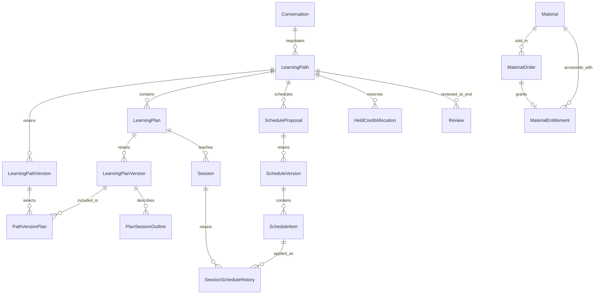

# Đề xuất điều chỉnh data model theo SRS SkillHub 1.5

Ngày đối chiếu: 05/10/2026. Báo cáo đề xuất này đã được phát triển thành hai sơ đồ và tài liệu data model có hậu tố `v2`; bản v1 được giữ nguyên. Prisma, migration và runtime chưa được cập nhật.

Quyết định phạm vi mới nhất của người dùng: **bỏ các phần OTP khỏi sơ đồ và danh mục field v2**, gồm challenge, guard, rate limit và payload gửi mã. Điều này không thay đổi hoặc tắt chức năng OTP runtime; DOCX nguồn được giữ nguyên.

Quyết định bổ sung về RBAC: **mỗi User có đúng một Role**. V2 bỏ UserRole, thêm users.roleId FK bắt buộc đến Role; RolePermission vẫn giữ để gán nhiều Permission cho từng Role. Đây là điều chỉnh thiết kế theo người dùng; runtime đa role hiện tại cần migration riêng khi triển khai.

Quyết định phạm vi tiếp theo: **bỏ Achievement/UserAchievement và danh hiệu được chọn trên Profile khỏi v2**. Giữ Reputation và xác minh kỹ năng; không sửa SRS DOCX nguồn.

SRS 1.5 thay đổi đơn vị nghiệp vụ trung tâm: **LearningPath là thỏa thuận; LearningPlan là lộ trình teacher tạo cho learner**. Cần bổ sung lịch sử phiên bản và xác nhận ở từng cấp, chuyển Hold/settlement/Review lên thỏa thuận, hỗ trợ thanh toán ONE_WAY và tài liệu số. Mô hình hiện tại vẫn theo 1.3 nên phải xử lý cả phần nghiệp vụ 1.4 còn thiếu.

## 1. Nguồn và bằng chứng hiện tại

- `SRS_SkillHub_V1.5.docx`: BR-13..24, BR-41..44; FR-AUTH-08, FR-PATH, FR-ONE, FR-MAT; mục 9, 18.3, 18.13..17, 18.32..42; AC-05..07, AC-10..14, AC-19..22.
- `SRS_SkillHub_V1.4_BoSungQuyDinhNghiepVu_VI.docx`: đối chiếu thay đổi theo mã rule/FR và nội dung, không theo số thứ tự bảng.
- `SkillHub_Entities_Fields.md`, `SkillHub_Logical_Data_Model.md`, hai sơ đồ `.drawio` và hai script `generate_*_model.py`: vẫn thể hiện Withdrawal, Review theo Session và thiếu LearningPath/LearningPlan.
- `services/api/prisma/schema.prisma`: thiếu LearningPath/LearningPlan và Material; Hold unique theo `(userId, sessionId)`; Review unique theo `(sessionId, reviewerId)`; Credit dùng BigInt nhưng đơn vị hiện là Credit nguyên.
- `services/api/prisma/chat.schema.prisma`: tham chiếu MongoDB, comment giới hạn chat vẫn là 10 MB.
- `services/api/src/configs/identity.config.ts`, `src/modules/users/application/services/users.service.ts`, Prisma Profile: Reputation có thể null hoặc khởi tạo theo cấu hình; chưa bảo đảm giá trị 50 đã chốt trong SRS.
- `services/api/README.md`, Prisma README và spec 002 còn chứa các mô tả cũ về settlement, withdrawal, số nguyên và Reputation. Schema catalog không chứng minh các feature đã chạy.

Đã đọc nội dung DOCX/OOXML; renderer không chạy được vì thiếu LibreOffice trong runtime. Báo cáo này đánh giá nội dung nghiệp vụ, không xác nhận bố cục hoặc số trang DOCX.

## 2. Mô hình conceptual đề xuất

Cardinality trên sơ đồ cho phép bản nháp chưa đủ dữ liệu. Khi Confirm/Lock, TWO_WAY bắt buộc đúng hai plan đối ứng A→B và B→A; ONE_WAY đúng một plan teacher→learner. Các bảng version, outline, settlement và schedule history là đề xuất thiết kế để thực hiện yêu cầu, không phải tên bảng bắt buộc của SRS. Xác nhận được lưu trực tiếp trên từng version theo phương án tối giản đã được người dùng chọn.

## 3. Entity và field cần thêm

| Model | Field chính đề xuất | Ràng buộc / căn cứ |
|---|---|---|
| `LearningPath` | `id`, `conversationId`, `participantAId`, `participantBId`, `currentVersion`, `lockedVersion`, `status`, timestamps | Giữ tên SRS; không tạo thêm một Agreement song song. Hai participant khác nhau. Quan hệ một hay nhiều thỏa thuận/Conversation chưa được SRS chốt; chưa đặt unique conversationId. |
| `LearningPathVersion` | PK `(pathId, version)`, `exchangeType`, `totalCreditPerUser?`, `negotiatedCredit?`, `teacherId?`, `learnerId?`, `createdBy`, `createdAt` | TWO_WAY: totalCreditPerUser ≥20, ONE_WAY fields null. ONE_WAY: negotiatedCredit >0, teacher/learner hợp lệ, totalCreditPerUser null. Giá trị chính thức thuộc snapshot đã xác nhận. |
| `LearningPlan` | `id`, `pathId`, `teacherId`, `learnerId`, `createdBy`, `currentVersion`, `status` | createdBy = teacherId; teacher ≠ learner; cả hai thuộc path. Unique `(pathId, teacherId, learnerId)` để không tạo plan đối ứng trùng; lịch sử sửa lưu ở version. |
| `LearningPlanVersion` | PK `(planId, version)`, `skillId`, `learningGoal`, `totalSessions`, `createdAt` | Snapshot bất biến; không ghi đè nội dung đã học. Status nghiệp vụ plan: DRAFT/PROPOSED/CONFIRMED/NEEDS_REVISION theo 18.39. |
| `PlanSessionOutline` | `planId`, `planVersion`, `sessionNo`, `content` | Unique `(planId, planVersion, sessionNo)`; số outline khớp totalSessions. Có thể dùng JSON có validation nếu chưa cần truy vấn từng outline; không dùng cả hai làm nguồn chính. |
| Xác nhận Plan trên `LearningPlanVersion` | `learnerConfirmedAt?` | Chỉ learner của plan được confirm; actor suy ra từ plan. Version mới khởi tạo NULL, giữ lịch sử version cũ; không tạo PlanConfirmation riêng. |
| `PathVersionPlan` | `pathId`, `pathVersion`, `planId`, `planVersion` | Composite FK đến hai snapshot; unique `(pathId, pathVersion, planId)`. Phải kiểm tra plan thuộc đúng path. Đảm bảo hai participant confirm cùng một tập plan/version. |
| Xác nhận Path trên `LearningPathVersion` | `participantAConfirmedAt?`, `participantBConfirmedAt?` | Chỉ A/B ghi timestamp tương ứng; đủ learner confirmation của các plan bắt buộc rồi mới đủ điều kiện CONFIRMED. Version mới khởi tạo NULL, không tạo PathConfirmation riêng. |
| Quyết toán trực tiếp trên `LearningPath` | `settledPathVersion`, `settlementOperationId` unique, `settlementFeePolicyId`, `settlementExchangeType`, `settlementGrossAmount`, `settlementFeeAmount`, `settlementFeeSnapshot`, `settledAt` | Gộp PathSettlement theo người dùng; cả nhóm NULL trước quyết toán, đầy đủ khi thành công. Khóa/check settledAt trên Path và operation idempotent, cập nhật nguyên tử cùng ledger/ví/Hold/state. Điều khoản phí snapshot khi chốt, không lấy config mới khi settle. |
| `FeePolicyVersion` | `policyCode`, `version`, `effectiveAt`, `approvedAt`, cách tính phí, rounding, trạng thái | Đề xuất lưu policy bất biến cho TWO_WAY/ONE_WAY/MATERIAL_PAID. Có thể tận dụng SystemConfiguration nhưng phải giữ lịch sử version và approval; bảng hiện tại chỉ giữ current value là chưa đủ. |
| `Material` | `id`, `ownerId`, `title`, `description`, `skillId`, `accessType`, `priceCredit`, metadata file trực tiếp, `listingVersion`, `moderationStatus`, `status`, timestamps | FREE giá 0; PAID giá >0; title 5–150, description 10–3000. listingVersion là đề xuất chống mua theo giá/metadata/file cũ; không tạo model phiên bản file riêng. |
| File trực tiếp trên `Material` | `storageKey`, `originalFilename`, `mimeType`, `sizeBytes`, `checksum`, `scanStatus`, `uploadedAt`, `distributionRightsConfirmedAt` | Bỏ MaterialVersion theo người dùng. Draft có thể chưa có file; PUBLISHED cần đủ metadata/CLEAN. Snapshot file đã bán lưu trên Order; MIME/size theo policy tài liệu riêng. |
| `MaterialOrder` | `id`, `buyerId`, `sellerId`, `materialId`, `purchasedFileSnapshot`, `listingVersion`, `grossCredit`, `feeRateSnapshot`, `feeAmount`, `sellerNetCredit`, `feePolicyVersion`, `status`, `idempotencyKey`, `createdAt` | Buyer ≠ seller; seller lấy từ owner phía server. gross = fee + net. Snapshot price/file/policy trước commit; status SUCCESS cùng ledger và entitlement. PurchasedFileSnapshot chứa metadata file bất biến, không FK phiên bản. |
| `MaterialEntitlement` | `id`, `userId`, `materialId`, `sourceOrderId?`, `grantedAt`, `status` | Unique `(userId, materialId)` cho quyền gốc theo rule không thu lại cùng material; sourceOrderId unique khi có. File đã mua lấy từ sourceOrder snapshot; quyền file thay thế còn mở. Bảo toàn lịch sử grant/revoke bằng audit hoặc bảng sự kiện. |

## 4. Điều chỉnh model đang có

| Model hiện tại | Điều chỉnh |
|---|---|
| `Proposal` | Thêm `sourceType`, `recipientId`, context skill/direct source theo feature; requestId nullable cho DIRECT_SEARCH. Check LEARNING_REQUEST phải có request, DIRECT_SEARCH không phụ thuộc request. proposedDurationMinutes optional 60–180; proposedCredit là gợi ý. Giữ partial unique PENDING `(requestId, proposerId)` cho nguồn request. |
| `Conversation` | requestId nullable theo Proposal; participant không suy ra chỉ từ request. Proposal ACCEPTED vẫn mở Chat trước Hold. |
| `ScheduleProposal` / `ScheduleVersion` | Gắn pathId và snapshot pathVersion đã Confirm. Chuyển quyền sở hữu giá cam kết khỏi ScheduleVersion sang LearningPathVersion; không tính tổng cam kết từ sessionCredit. Giữ lịch sử version và hai confirmation theo version. |
| `ScheduleItem` | Thêm planId, planVersion, outline/sessionNo; kiểm tra thuộc snapshot path đã Confirm. Unique số buổi trong từng plan/version lịch; count khớp số buổi của mỗi plan, duration 60–180 phút. sessionCredit bỏ khỏi mô hình cốt lõi; không tự chia Credit cho từng Session. |
| `Session` | Gắn pathId, lockedPathVersion, planId/planVersion, teacherId/learnerId; nội dung/skill lấy đúng snapshot. Lưu status/time/note xác nhận riêng của teacher và learner ngay trên Session, cùng roomName/providerRoomId/roomMetadata; không có SessionConfirmation/LiveKitRoom riêng. Session COMPLETED chỉ cập nhật tiến độ; tất cả Session của cả hai plan mới cho phép final settlement TWO_WAY. |
| `Session` / lịch thay đổi | Bổ sung quan hệ lịch áp dụng hiện tại và lịch sử áp dụng, ví dụ `SessionScheduleHistory(sessionId, scheduleItemId, appliedAt)`. Giữ một Session ổn định khi reschedule thay vì tạo buổi mới/đếm lại; proposal chưa đủ Confirm không thay lịch hiện hành. Buổi đã hoàn thành không sửa. |
| `HeldCreditAllocation` | Chuyển unique `(userId, sessionId)` thành `(pathId, userId)`; thêm lockedPathVersion, purpose, beneficiaryId? và policy snapshot. TWO_WAY hai allocation, ONE_WAY một allocation của learner. amount/remainingHeld theo cả thỏa thuận. Nếu cần penalty theo buổi, bổ sung mapping phụ sau khi có policy; chưa tự phân bổ tiền mỗi buổi. |
| `CreditWallet` / `CreditTransaction` / `Payment` | Quy định đơn vị precision 2 chữ số đồng nhất; giữ availableDelta/heldDelta và after-balances. Payment thêm conversionRate snapshot 1.000 VND/Credit. Giữ purchased/bonus nếu dùng như dữ liệu nguồn; không coi chúng là bucket được cộng thêm vào available+held. |
| `CreditTransaction` | Thêm operationId/groupId để gom debit/credit/fee; reference LEARNING_PATH và MATERIAL_ORDER. Unique từng entry operation/type/wallet để retry không trùng; unique operation settlement/order ở bảng nghiệp vụ. Thêm reversesTransactionId nếu cần truy vết refund/đảo. |
| `Review` | sessionId thay bằng pathId; unique `(pathId, reviewerId)`; reviewer/reviewee là hai participant khác nhau; chỉ mở sau toàn thỏa thuận hoàn tất. ONE_WAY tiếp tục có review theo SRS, không tự giới hạn chỉ learner được đánh giá. |
| `UserLearnedSkill` | Thay nguồn scheduleProposalId bằng sourcePlanId và sourcePathId; chỉ grant learner đúng skill của plan đã hoàn tất thỏa thuận. Unique event grant, ví dụ `(userId, skillId, sourcePlanId)`; teacher ONE_WAY không tự được thêm skill. |
| `LearningRequest` | Bổ sung moderationStatus, flaggedReason/matchedRules, rejectReason, reviewedBy/At; enum business thêm PENDING_MODERATION/REJECTED. Gắn contentVersion cho lần duyệt để edit không dùng approval cũ. Expected duration/budget cũ phải xem là suggestion hoặc loại khỏi field bắt buộc vì 18.10 không còn bắt buộc. |
| `SkillEvidence` / `SkillVerification` | Evidence có approval status, reviewer/reviewedAt, revokedAt/reason/by và scan metadata; file mới được duyệt riêng, approval cũ giữ hiệu lực. Không expiry tự động. Verification là nhóm lần nộp, không thay toàn bộ lịch sử bằng trạng thái của lần mới nhất. |
| `User` / `ReputationHistory` | Profile đã gộp vào User theo quyết định người dùng. Reputation khởi tạo 50, range 0–100, nguồn duy nhất ở User; thêm reasonCode, delta, ruleVersion, source/event idempotency ở lịch sử. Cap completion +10/tháng tính từ lịch sử có nguồn rõ ràng. |
| Hạn chế tài khoản | Đề xuất `UserRestriction(userId, scope, startsAt, endsAt, source, reason, revokedAt)` để biểu diễn cấm tạo request/proposal nhưng vẫn học lịch đã chốt. Account LOCKED chung không biểu diễn được mức 30–39; phân biệt hạn chế hoạt động và khóa tài khoản. |
| Phân loại kỹ năng | Bỏ SkillTag và hai bảng nối LearningRequestTag/MaterialTag theo người dùng. Giữ SkillCategory/Skill; Request/Material dùng skillId hiện có để lọc/phân loại, không thêm mảng tag hoặc nhiều-nhiều thay thế. Yêu cầu nhiều tag trong SRS được loại khỏi phạm vi thiết kế v2; DOCX nguồn không sửa. |
| `ReportCase` | Thêm relatedPathId, relatedMaterialId/relatedOrderId khi cần FK và cờ/quyết định chặn settlement. Report học kiểm tra membership; report MATERIAL/ORDER không bắt buộc path/session. Thêm target MATERIAL/MATERIAL_ORDER, chuẩn hóa CREDIT_TRANSACTION thay TRANSACTION hoặc có mapping contract. |
| `Message` / attachment | Nhúng mảng attachments vào Message, giữ ID/MIME/storageKey/size/scan/checksum từng file; không có collection MessageAttachment riêng. Structured event reference objectId/version, dedupe event id cho delivery. Chat tối đa 15 MB/file theo AC-17; riêng evidence/material dùng policy riêng. Business confirmation thuộc PostgreSQL, message chỉ phản chiếu event qua outbox/Mongoose. |
| `Notification` / `AuditLog` | Bổ sung vocabulary sự kiện ở 18.42 và version/context cần truy vết; không đưa storageKey/token vào notification. Financial decision/audit critical cùng transaction nghiệp vụ; notification sau commit với outbox/idempotent retry. |
| `Withdrawal` | Loại model/enum/relation và vocabulary WITHDRAWAL khỏi catalog phạm vi 1.5. Nếu DB thực tế có lịch sử thì lưu trữ/bảo toàn trước migration, không drop dữ liệu dựa trên catalog. |

## 5. Credit và tính nguyên tử

**Đề xuất giữ quyết định kiến trúc integer units hiện tại và chuyển BIGINT sang đơn vị 1/100 Credit**: 20 Credit = 2.000 units; 100,25 Credit = 10.025 units. Tất cả amount, delta, after-balance, commitment, proposedCredit, Payment.creditAmount, fee và material price phải cùng đơn vị. API phải công bố rõ conversion; không đổi nghĩa field âm thầm. VND vẫn integer.

SRS cho phép cả decimal và integer đơn vị nhỏ nhất (9.1, CR-002). Một phương án khác là Decimal(12,2) toàn bộ Credit, nhưng cần ghi nhận sửa quyết định integer của constitution và thống nhất contracts. Dù chọn cách nào, không dùng Number/float nhị phân để tính tiền. BigInt hiện tại lưu Credit nguyên chưa đáp ứng giá 2 chữ số; chỉ đổi mô tả mà không đổi toàn bộ phép tính là sai.

Các transaction bắt buộc:

1. **Lock**: khóa/check path version và plan confirmation + hai schedule confirmation; kiểm tra quyền/account, count/duration/conflict cả hai và wallet phải trả; tạo allocation/HOLD, cập nhật ví, khóa lịch, tạo Session nguyên tử. Retry reschedule không HOLD lần hai. Race final confirm so với edit phải kiểm tra version trong cùng transaction.
2. **TWO_WAY settle**: sau tất cả Session của hai plan và không dispute giữ Credit, từng allocation trả về chính chủ 96%, phí 4%; amountReturned = gross − fee sau rounding đã chốt. Ví dụ 20 Credit/User → trả 19,20 và phí 0,80/User. Unique final settlement/path; COMPLETE, ledger, allocations và ví cùng commit.
3. **ONE_WAY settle**: learner Held giảm gross, teacher Available tăng gross − fee, fee ghi theo snapshot. Không hoàn 96% về learner, teacher không HOLD. Fee policy chưa được phê duyệt/cấu hình thì chặn. Quy tắc timing gate trước Hold cần làm rõ ở mục 6.
4. **PAID material buy**: khóa/check material snapshot, entitlement và ví theo thứ tự ổn định; buyer Available giảm gross, seller tăng net, fee ghi riêng, order SUCCESS và entitlement cùng commit. Retry cùng request hoặc request mới khi đã có quyền trả order/quyền cũ. Unique entitlement + wallet locking phải bảo vệ cả hai kiểu race.
5. **Refund/dispute**: tạo entry đối ứng và audit; không sửa ledger đã SUCCESS. Quyết định material refund/revoke phải xử lý entitlement cùng transaction theo policy được chốt. Không dùng khoản Hold của Path khác.

`PLATFORM_FEE` phải được thiết kế tránh trừ ví hai lần: nếu TEACHING_PAYMENT/MATERIAL_PURCHASE đã debit toàn gross, entry fee là phân bổ phí hoặc credit tài khoản nền tảng, không thêm debit người trả. Invariant tổng debit = tổng credit người nhận + phí. FeePolicy/PathSettlement là đề xuất thiết kế, không cho phép tự đặt phí 4% cho luồng mới.

Enum giao dịch theo 18.15: TOP_UP, DAILY_BONUS, FEEDBACK_BONUS, HOLD, RELEASE, PATH_RETURN, PLATFORM_FEE, TEACHING_PAYMENT, TEACHING_EARNING, MATERIAL_PURCHASE, MATERIAL_SALE, REFUND, PENALTY, ADJUSTMENT. SESSION_RETURN/SESSION_EARNING của catalog cũ cần mapping khi có lịch sử; không giữ như settlement chuẩn 1.5.

## 6. Điểm chưa rõ và mâu thuẫn cần ghi nhận

| Vấn đề | Nội dung cần chốt trước phần triển khai phụ thuộc |
|---|---|
| Field skill chung | 18.13 vẫn ghi skillId/learningGoal ở LearningPath là bắt buộc, nhưng 18.32/18.39 đặt ở từng plan và cho phép hai skill khác nhau. Đề xuất plan version là nguồn chính, Path field chỉ projection hiển thị. |
| Credit cam kết TWO_WAY | SRS dùng một totalCreditPerUser, có thể hiểu cùng số tiền cả hai. Đề xuất bám một mức chung hiện tại; chưa thêm amountA/amountB khi chưa xác nhận cho phép mức khác nhau. |
| Giá trong lịch | PP-005 vẫn gọi ScheduleProposal là giá trị Credit chính thức, trái 18.13/18.40. Đề xuất sửa SRS: PathVersion là nguồn giá; ScheduleVersion là nguồn thời gian. |
| Phí và thời điểm khóa policy | ONE_WAY/MATERIAL cần fee/min/max/rounding riêng; chưa cấu hình thì không settle/mua. FR-ONE-03 yêu cầu snapshot khi chốt: nên có policy trước Lock/Hold để user biết giá cuối; SRS cần xác nhận gate này. TWO_WAY rounding 2 chữ số cũng cần rule rõ. |
| Amendment sau Lock | Quy trình tăng/giảm buổi/giá, giữ Session đã học, tính bù Hold và xử lý đổi TWO_WAY↔ONE_WAY sau lock chưa đủ chi tiết. Không tự cho đổi loại/vai trò sau lock; chưa tự settle theo từng amendment. |
| Material ẩn và quyền đã mua | “Chỉ PUBLISHED/CLEAN được truy cập” ở 18.41 và yêu cầu quyền đã mua xử lý theo policy ở FR-MAT-06 cần thống nhất: HIDDEN/ARCHIVED có chặn người đã mua hay chỉ mua mới, refund/revoke lúc nào? File scan không CLEAN luôn phải chặn. |
| Quyền file version mới | Cấp quyền version đã mua hay cả version mới; FREE nhận version mới; quyền sau refund và khi entitlement bị revoke. Rule không thu lại cùng material cần định nghĩa rõ trường hợp revoke/refund muốn mua lại. |
| Một hay nhiều thỏa thuận/Conversation | Chưa chốt cardinality và giới hạn số thỏa thuận đang hoạt động; không hard-code one-to-one. |
| Review/reputation ONE_WAY | Completion +1/User và Review cuối Path vẫn áp dụng theo mô tả chung; khóa tài khoản thấp điểm có cản dạy/học đã chốt không cần acceptance cụ thể. |
| Policy còn mở | OP-01..06, OP-13/14: cancel/no-show, completion timeout, dispute window, quyền Staff, upload/MIME/retention/preview tài liệu, các mức bonus. Không chuyển những giá trị đã chốt 50/20/1.000/60–180/60 phút thành câu hỏi lại. |

## 7. Thứ tự cập nhật và kiểm chứng

1. Chốt thuật ngữ/thẩm quyền field, đơn vị Credit và open policies; cập nhật Entities_Fields + Logical_Data_Model.md theo 1.5, có nhãn SRS/đề xuất/chưa chốt.
2. Đồng bộ generator và hai `.drawio` v2: thêm Path/Plan/version/confirmation/material, thay quan hệ Hold/Review; bỏ Withdrawal, UserRole, Achievement và các cấu trúc OTP theo phạm vi đã chốt. Giữ nguyên generator/artifact v1.
3. Cập nhật Prisma catalog, Prisma README và API README theo mô hình mới; phân biệt catalog, deployment scope và runtime. Dữ liệu auth/identity hiện có cần spec amendment riêng, không sửa lịch sử validation cũ thành đã đạt 1.5.
4. Phần identity trong v2 giữ một Role/User và Reputation 50; khi triển khai cần migration mapping role và backfill Reputation null có kiểm soát, giữ nguyên điểm đã có lịch sử. Các cấu trúc OTP không thuộc phạm vi sơ đồ v2; runtime hiện tại chưa thay đổi.
5. Triển khai Path/Plan/Scheduling/Credit rồi Materials theo feature riêng. Kiểm tra schema/migration, transaction rollback, quyền participant và concurrency thực trên PostgreSQL; schema validation chỉ chứng minh cấu trúc hợp lệ.

Acceptance trọng tâm: chặn tự tạo/tự confirm plan, stale versions và TWO_WAY thiếu plan; ONE_WAY teacher 0 Credit vẫn chốt được khi learner đủ tiền; hoàn từng buổi chưa settle; settle/retry không trùng; reschedule giữ Session và không Hold lại; material mua đồng thời/giá đổi/version đổi/đã có quyền/refund; không cấp entitlement khi payment fail; wallet không âm và ledger bảo toàn Credit.

Đã tạo `SkillHub_Conceptual_Data_Model_v2.drawio`, `SkillHub_Logical_Data_Model_v2.drawio`, `SkillHub_Logical_Data_Model_v2.md` và `SkillHub_Entities_Fields_v2.md`; format sơ đồ một canvas tương tự v1. Chưa chạy test backend vì không sửa runtime/schema. Không sửa DOCX nguồn, artifact v1, Prisma, migration hoặc dữ liệu ứng dụng.

Đã tối giản 8 model theo quyết định tiếp theo của người dùng: Plan/Path/ScheduleConfirmation thành timestamp trên đúng version; SessionConfirmation thành status/time/note hai role trên Session; LiveKitRoom thành room metadata trên Session; RequestPreferredSlot/ProposalCandidateSlot thành mảng JSON tối đa 5 khung giờ trên model cha; MessageAttachment thành mảng subdocument của Message. ScheduleVersion có participantAConfirmedAt/participantBConfirmedAt, version mới chưa xác nhận. Logical còn 56 model (55 PostgreSQL, 1 MongoDB); conceptual còn 41 entity. Giữ PlanSessionOutline, SessionAttendance và các model lịch sử/giao dịch/quyền tài liệu. Chi tiết quyền actor, dữ liệu nhúng và transaction nằm trong Logical Data Model v2.

Đã bỏ thêm MaterialVersion: metadata file hiện tại lưu trên Material, snapshot file đã mua lưu trong MaterialOrder, bỏ currentFileVersionId/purchasedVersionId/grantedVersionId/versionScope. Không còn catalog phiên bản riêng; object đã bán được bảo toàn theo quyền/retention và scan/download vẫn kiểm tra hiện hành. Tổng hiện tại là 55 model logical (54 PostgreSQL, 1 MongoDB), 40 entity conceptual.

Đã gộp Profile vào User: fullName/headline/bio/avatarAssetId/timezone/locale/Reputation và counter nằm trực tiếp trên User; dùng một userId và updatedAt, chuyển quan hệ chọn AvatarAsset sang User. Không còn bảng/entity Profile trong v2. Hồ sơ công khai chỉ project field cho phép, không lộ dữ liệu bảo mật; Reputation/counter vẫn do server quản lý. Tổng mới nhất: 54 model logical (53 PostgreSQL, 1 MongoDB), 39 entity conceptual. Chưa thay đổi Prisma/runtime hoặc migration hồ sơ hiện có.

Đã gộp PathSettlement vào LearningPath: giữ các field version/operation/policy/loại/số tiền/phí/snapshot/thời điểm quyết toán nullable theo nhóm, chuyển các quan hệ tương ứng sang Path. Không có entity PathSettlement riêng; FeePolicy vẫn giữ. Khóa Path/check settledAt kết hợp operation idempotency và transaction nguyên tử giữ một lần quyết toán/path. Tổng mới nhất: 53 model logical (52 PostgreSQL, 1 MongoDB), 38 entity conceptual; chưa sửa Prisma/runtime/migration.

Đã bỏ SkillTag và hai bảng nối LearningRequestTag/MaterialTag. SkillCategory/Skill giữ nguyên; Request/Material vẫn tham chiếu skillId. Tổng mới nhất: 50 model logical (49 PostgreSQL, 1 MongoDB), 37 entity conceptual; chưa sửa Prisma/runtime/migration.

Đã gộp SessionAttendance vào Session: teacher/learner có firstJoinedAt, lastLeftAt và attendanceSeconds riêng; timestamp nullable, duration không âm mặc định 0. Bỏ model attendance và các relation riêng, không lưu lịch sử từng lần vào/ra. Duration là thời gian kết nối thực, không lấy lastLeft−firstJoined; webhook dedupe/out-of-order và reconciliation cần thiết kế khi triển khai. Attendance không thay xác nhận hoàn thành. Tổng mới nhất: 49 model logical (48 PostgreSQL, 1 MongoDB), 36 entity conceptual; chưa sửa Prisma/runtime/migration.
