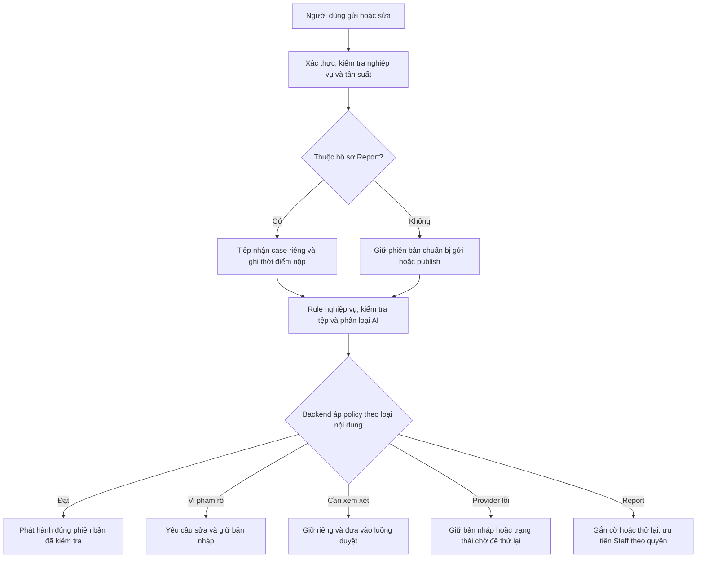

# Kế hoạch triển khai kiểm duyệt nội dung SkillHub

> Khi triển khai từng task, dùng `superpowers:executing-plans` hoặc `superpowers:subagent-driven-development` theo cách làm đã chọn. Các checkbox theo dõi từng bước triển khai và kiểm chứng.

**Mục tiêu** — Tự động kiểm duyệt nội dung do người dùng tạo hoặc sửa trước khi nội dung được công khai hoặc gửi cho người khác, đồng thời tiếp nhận Report đúng hạn.

**Kiến trúc** — Backend dùng một dịch vụ phân loại chung. `omni-moderation-latest` là lớp AI chính. Module nghiệp vụ áp dụng kết quả theo loại nội dung và giữ quyền quyết định trạng thái, thông báo và tác động nghiệp vụ.

**Công nghệ** — NestJS 11, TypeScript, PostgreSQL/Prisma, MongoDB/Mongoose, outbox và Redis/BullMQ hiện có, OpenAI Moderations API, Node test runner.

**Căn cứ** — Phạm vi và cách xử lý đã thống nhất trong trao đổi ngày 2026-11-20, các ràng buộc bên dưới, [SRS 1.6 §18.12 và §18.38](../../SRS_SkillHub_V1.6_VietLai_DongBoNghiepVu.docx) và [Constitution](../../../services/api/.specify/memory/constitution.md). Tài liệu [Source of Truth](../../SOURCE_OF_TRUTH.md) chỉ định [SRS 1.7](../../SRS_SkillHub_V1.7_Reputation_Recovery.docx). Hai bản có cùng yêu cầu về lọc từ khóa khi publish Learning Request và cùng để mở chính sách truy cập/lưu giữ chat. Điểm xuất phát khi rà nguồn là `dev` tại `74583297`. Đối chiếu lại với head của nhánh triển khai trước khi sửa code.

## Phạm vi và ràng buộc

- Bao phủ nội dung tự nhập và tệp do người dùng gửi để công khai, chia sẻ với người dùng khác hoặc nộp vào case. Bao gồm tạo mới, sửa, publish, gửi lại và thay thế tệp. Các giá trị cấu trúc như điểm sao, lịch, mã lý do và dữ liệu xác thực đi qua kiểm tra nghiệp vụ hiện hành.
- Omni được gọi qua `POST /v1/moderations`. API nhận `model` và `input` với các nhóm phân loại định sẵn. Chính sách riêng có thể dùng OpenAI Decisions API trong đợt thử nghiệm nếu đo được lỗ hổng có hệ thống. [Moderations API](https://developers.openai.com/api/reference/resources/moderations/methods/create) · [Decisions API](https://developers.openai.com/api/docs/guides/decisions)
- Giữ rule chặn thông tin liên hệ trong chat và cấu hình từ khóa Learning Request hiện có. Dùng kết quả AI để giảm việc bổ sung từng biến thể câu. Phần quyền Admin của đợt này dùng quyền và audit hiện có. Việc quản lý danh sách NG words toàn hệ thống chỉ đặt lại khi có yêu cầu nghiệp vụ cụ thể.
- AI phân loại nội dung. Backend quyết định chặn, yêu cầu sửa, giữ chờ hoặc cho qua. Kết quả kiểm duyệt tự động chỉ tác động đến nội dung. Xử lý vi phạm tài khoản tiếp tục qua quy trình có thẩm quyền.
- Staff xử lý trường hợp cần duyệt theo nghiệp vụ, khiếu nại và case. Learning Request bị gắn cờ dùng hàng đợi `PENDING_MODERATION` hiện có. Report hợp lệ được nhận trước, rồi mới phân loại để ưu tiên và kiểm soát hiển thị trong case.
- Kiểm duyệt phiên bản được gửi. Phạm vi triển khai chỉ gồm backend và hợp đồng Swagger. Nội dung đã phát hành trước rollout được rà riêng trước khi xét quét lại.

## Tiêu chí chặn

Nội dung thuộc bất kỳ nhóm nào dưới đây đều bị chặn phát hành khi đã xác định vi phạm. Với chat, người gửi giữ bản nháp để sửa. Với nội dung có bước duyệt theo SRS, bản bị gắn cờ được giữ riêng theo quy trình của module. Report hợp lệ vẫn được tiếp nhận để Staff có thể xem trích dẫn và bằng chứng trong phạm vi case.

| Nhóm | Tín hiệu và cách áp dụng |
| --- | --- |
| Nội dung về tình dục | Dùng tín hiệu thuộc nhóm `sexual` và `sexual/minors` trong phạm vi dữ liệu model hỗ trợ. Ghi nhận các trường hợp biên như nội dung giáo dục sức khỏe để chốt cách gán nhãn trước khi bật chặn. |
| Nội dung bạo lực | Dùng tín hiệu `violence`, `violence/graphic` và các nhóm liên quan đến đe dọa. Bộ đánh giá bao gồm cả rủ rê hoặc xúi giục đánh nhau diễn đạt gián tiếp, kể cả khi Omni cho qua. |
| Nội dung “phản động” theo yêu cầu bổ sung | Omni chưa có nhóm tương ứng. Product Owner cần xác định hành vi cụ thể và duyệt ví dụ vi phạm, ví dụ hợp lệ và trường hợp mơ hồ trước khi tự động chặn. Một quan điểm chính trị hoặc một từ khóa riêng lẻ chưa đủ căn cứ để chặn. |
| Nội dung không phù hợp với SkillHub | Áp dụng các điều khoản sản phẩm đã duyệt, ví dụ quấy rối, thù ghét hoặc chia sẻ thông tin liên hệ trong chat. Các trường hợp mới cần tiêu chí và ví dụ được duyệt trước khi đưa vào chính sách tự động. |

Omni là nguồn tín hiệu cho các nhóm model hỗ trợ. Với tiêu chí riêng đã được duyệt mà không có nhóm tương ứng, thử OpenAI Decisions API trên bộ mẫu riêng trước khi bật tự động chặn. Trong thời gian đó, áp dụng các quy tắc nghiệp vụ hiện có và chuyển trường hợp cần xem xét theo quy trình Staff. [Các nhóm nội dung Omni hỗ trợ](https://developers.openai.com/api/docs/guides/moderation#review-supported-categories)

## Kiến trúc và hợp đồng chung

- Tạo module `services/api/src/modules/content-moderation`, đăng ký tại `services/api/src/app.module.ts`. Hợp đồng nội bộ dự kiến là `ContentModerationService.evaluate(input: ModerationInput): Promise<ModerationAssessment>`. `ModerationInput` gồm `surface`, `sourceVersion`, `digest`, phần text cần kiểm tra và tệp ảnh đủ điều kiện nếu có. Module gọi dịch vụ giữ ID nghiệp vụ, kiểm tra quyền và quyết định dữ liệu tối thiểu cần gửi.
- `ModerationAssessment` gồm `outcome: ALLOW | BLOCK | REVIEW | RETRY`, `reasonCodes`, `policyVersion`, `classifierVersion` và định danh kết quả. Với Report, các outcome chỉ phục vụ phân loại nội dung, quyền hiển thị và tiến độ kiểm tra của case. Trạng thái nghiệp vụ của case do module Report sở hữu.
- Fingerprint bao gồm nội dung sẽ hiển thị và phiên bản tệp. Gọi provider ngoài transaction. Khi commit, kiểm tra lại quyền, phiên bản và fingerprint rồi ghi quyết định với thay đổi trạng thái/outbox thích hợp. Retry cùng yêu cầu tái sử dụng kết quả đã lưu khi phù hợp. Nội dung thay đổi phải được đánh giá lại. Job chỉ chứa tham chiếu để lấy dữ liệu từ module sở hữu.
- Dùng cơ chế validate môi trường tại startup cho key, timeout, model và chế độ theo loại nội dung. Theo dõi riêng tín hiệu từ rule, provider và policy. Log các mã lý do, phiên bản, thời gian xử lý và mã truy vết. Dữ liệu riêng đi qua kiểm soát truy cập của resource gốc.
- Contract mới cho chat dự kiến dùng `422 CONTENT_MODERATION_BLOCKED` và `503 CONTENT_MODERATION_TEMPORARILY_UNAVAILABLE` theo error envelope hiện hành. Chat mơ hồ trong nhóm cần kiểm tra thêm trả hướng dẫn diễn đạt lại hoặc giữ chờ theo policy đã duyệt. Phần hiển thị công khai dùng trạng thái nghiệp vụ của module. Cập nhật Swagger và kiểm tra tương thích trước khi bật.

## Review Focus

| Tình huống | Điều cần kiểm chứng | Task |
| --- | --- | --- |
| Omni cho qua câu xúi giục diễn đạt gián tiếp | Tập đánh giá có mẫu được Omni cho qua để đo phần cải thiện của lớp tùy chỉnh. | 1, 7 |
| Tin bị từ chối sau khi đã tạo receipt chuẩn bị | Retry và tra delivery trả kết quả phù hợp. Recipient history, inbox, SSE và notifications không có tin bị chặn. | 2 |
| Staff duyệt trong lúc tác giả sửa và retry review | Quyết định cũ không phát hành bản mới. Reputation và thành tích chỉ chạy một lần cho review hợp lệ. | 3 |
| Provider gián đoạn lúc sắp hết hạn Report | Report được ghi nhận theo thời điểm và điều kiện hiện hành. Case/settlement xử lý như trước. | 4 |
| Tệp thay thế hoặc scan xong theo thứ tự khác | Phát hành đúng checksum đã được scan và duyệt. Chỉ người có quyền của case đọc được bằng chứng. | 4, 6 |

## Task 1 Tạo lớp phân loại và bộ đánh giá tiếng Việt

**Files** — Tạo `services/api/src/modules/content-moderation/content-moderation.module.ts`, `application/content-moderation.service.ts`, `domain/moderation-policy.ts` và `infrastructure/openai-moderation.client.ts` bên trong module. Sửa `services/api/src/app.module.ts`, validate env hiện hành và `services/api/.env.example`. Tạo `services/api/test/content-moderation/policy.test.mjs`, `provider.test.mjs` và `fixtures/vi-cases.json` trong cùng thư mục test.

- [ ] Viết test cho `evaluate()` với stub trả ALLOW, BLOCK, REVIEW, timeout, 429, 5xx và payload sai schema. Payload sai và lỗi provider phải ra RETRY. Test request chỉ có input được chọn và model. Test context và nội dung không xuất hiện trong log.
- [ ] Tạo bộ mẫu do team gán nhãn cho từng nhóm tiêu chí, với ca vi phạm, ca hợp lệ dễ nhầm và ca mơ hồ. Bao gồm câu thách đánh nhau trong lúc cãi vã, “đấm bố đi” đứng riêng hoặc có ngữ cảnh xúi đánh người thật, trao đổi tập võ, nội dung giáo dục sức khỏe, thảo luận thời sự trung tính, review tiêu cực hợp lệ, chữ trong screenshot và trích dẫn trong Report. Dùng dữ liệu tổng hợp hoặc đã được phép sử dụng. Ghi kết quả kỳ vọng theo `surface`.
- [ ] Chạy test sau khi build để xác nhận phần adapter và policy chưa đáp ứng. Triển khai adapter HTTP với timeout hữu hạn, kiểm tra schema response và policy theo loại nội dung. Thiết lập mặc định cho môi trường kiểm thử với dữ liệu tổng hợp.
- [ ] Build API, chạy các test trong `test/content-moderation`. Xác nhận lỗi upstream, nội dung được gửi và quyết định theo nhóm đúng với fixture. Đo baseline Omni trên staging khi có project key được cấp cho việc thử nghiệm.

## Task 2 Bảo vệ luồng chat sau khi accept Proposal

**Files** — Sửa `services/api/src/modules/conversations/application/services/conversations.service.ts`, `conversations.module.ts` và HTTP controller/responses của module. Mở rộng test ở `services/api/test/connections/inbox-messages.test.mjs` và `inbox-messages.integration.test.mjs`.

- [ ] Viết test API trực tiếp cho participant hợp lệ và người ngoài Conversation, nội dung bị chặn, response bị mất, lỗi provider, concurrent retry và edit gửi bằng ID mới. Kiểm tra tin đã commit trước khi retry vẫn trả delivery hiện hữu.
- [ ] Chạy `pnpm --filter api test:connections` để xác nhận các ca mới chưa đạt. Tích hợp `evaluate()` sau kiểm tra quyền và rate limit, trước khi commit `chat.message.publish`. Giữ receipt chỉ người gửi thấy trong giai đoạn chuẩn bị. Ghi nhận từ chối ở trạng thái kết thúc để tra delivery và cleanup xử lý nhất quán. Thử lại cùng `clientMessageId` cho cùng nội dung khi lỗi tạm thời.
- [ ] Chạy lại `test:connections` và `test:connections:regression`. Với PostgreSQL và MongoDB test riêng, kiểm tra cả receipt, Mongo history, inbox preview, SSE, notification và khả năng gửi lại sau khi sửa.

## Task 3 Gắn kiểm duyệt vào nội dung công khai

**Files** — Sửa `services/api/src/modules/learning-requests/application/use-cases/publish-learning-request.use-case.ts`, `edit-learning-request.use-case.ts`, `services/api/src/modules/reviews/application/services/reviews.service.ts`, `services/api/src/modules/materials/application/services/material-reviews.service.ts` và `materials.service.ts`. Rà các reader/projection trong các module sở hữu và `users/application/services/public-review-reader.ts`. Khi cần persistence, dùng migration mới và schema/workflow của module sở hữu. Bổ sung ca kiểm thử vào `services/api/test/learning-requests`, `test/learning-platform` và các suite Review/Material tương ứng.

- [ ] Viết ca kiểm tra publish/sửa Learning Request, submit/sửa review và submit/sửa tài liệu. Assert draft/bản chờ không đi vào feed, search, danh sách công khai, notification hoặc điểm tổng hợp. Assert bản duyệt cũ không phê duyệt bản sửa mới.
- [ ] Learning Request kiểm tra toàn bộ trường tự nhập đang dùng khi publish/edit. Kết hợp kết quả Omni với bộ lọc hiện tại. Bản đạt đi tiếp theo điều kiện publish hiện hành. Bản bị gắn cờ dùng `PENDING_MODERATION`, và Staff duyệt theo version. Tác giả có thể sửa và gửi lại theo luồng hiện hành.
- [ ] Kiểm tra nhận xét review trước khi tạo review chính thức hoặc sửa phiên bản công khai. Review lộ trình chỉ gọi Reputation/achievements trong transaction chấp nhận review hợp lệ, đúng một lần. Review tài liệu giữ luồng chỉnh sửa/ẩn đã có và kiểm tra rating summary trước và sau khi chấp nhận. Review tiêu cực hợp lệ tiếp tục đi qua luồng bình thường.
- [ ] Kiểm tra metadata tài liệu gồm tiêu đề, mô tả, tag/tên hiển thị tự nhập. Gắn trạng thái tệp thuộc Task 6 vào bước có thể publish hoặc cấp quyền truy cập phiên bản mới.
- [ ] Chạy các ca mới trước và sau tích hợp. Xác nhận `test:learning-request`, `test:public-reviews`, `test:learning-platform` và `test:materials` đạt. Chạy các suite tích hợp tương ứng với PostgreSQL test riêng để kiểm tra phiên bản và tác động Reputation.

## Task 4 Tiếp nhận Report đúng hạn và bảo vệ bằng chứng

**Files** — Sửa `services/api/src/modules/reports/application/services/reports.service.ts`, `case-messages.service.ts`, `report-support.service.ts` và `services/api/src/modules/materials/application/services/material-reports.service.ts`, `material-reviews.service.ts`. Mở rộng test ở `services/api/test/report-support.test.mjs` và `session-report-contracts.test.mjs`.

- [ ] Viết ca Report trích dẫn lời đe dọa, Report bị gửi trùng, provider gián đoạn ngay trước cutoff và evidence bị thay thế trước lúc worker hoàn tất. Assert quyền Staff theo case, thời điểm nhận, chuyển `DISPUTED` và chặn settlement đúng điều kiện hiện hành. Kiểm tra log đã loại dữ liệu bằng chứng.
- [ ] Giữ tiếp nhận Report hợp lệ đồng bộ theo thời điểm DB. Lưu tham chiếu hoặc outbox kiểm duyệt cùng transaction tiếp nhận. Worker phân loại sau commit và cập nhật metadata của đúng phiên bản để Staff ưu tiên xem. Report nhạy cảm, evidence chưa sẵn sàng và tin nhắn cần hạn chế hiển thị đi theo quyền của case. Dùng kết quả phân loại để hỗ trợ Staff xác minh.
- [ ] Chạy `pnpm --filter api test:report-support` và suite Materials có ca report review/tài liệu. Kiểm thử trên DB test việc provider thất bại không làm mất Report đúng hạn và kết quả AI không quyết định settlement hay xử lý tài khoản.

## Task 5 Bổ sung các điểm nhập nội dung còn lại

**Files** — Rà các điểm tạo/sửa trong `services/api/src/modules/auth/application/use-cases/register.use-case.ts`, `users/application/use-cases/update-profile.use-case.ts`, `sharing-skills/application/services/sharing-skills.service.ts`, `skills/application/services/tag-requests.service.ts`, `proposals/application/services/proposals.service.ts`, `learning-paths/application/services/learning-paths.service.ts` và các controller của `scheduling`, `learning-sessions` và `learning-paths` có ghi chú/lý do người dùng gửi. Kiểm tra các điểm trả phí/phản hồi chỉ khi free text được gửi cho bên khác hoặc mở case.

- [ ] Lập danh mục route và field theo điểm thực thi, đối tượng nhìn thấy, phiên bản và cách retry. Gắn mỗi điểm ghi nội dung với gate đồng bộ, kiểm tra trước khi phát hành hoặc kiểm tra sau khi tiếp nhận case. Đối chiếu với OpenAPI và các event/card hiện có để bao phủ cả đường cập nhật gián tiếp.
- [ ] Viết ca qua các API chính cho profile/display name, Sharing Skill, tag đề xuất, lời nhắn Proposal, mô tả LearningPlan, ghi chú và lý do thay đổi. Bao phủ tên công khai đi từ đăng ký sang profile và text do người dùng nhập được đưa vào card do hệ thống dựng.
- [ ] Gắn gate tại module sở hữu trước điểm người khác có thể đọc. Dùng dữ liệu phiên bản đã qua gate khi tạo card/event. Giữ các giá trị cấu trúc và giao dịch nghiệp vụ theo contract hiện hữu.
- [ ] Chạy các suite thay đổi qua `pnpm --filter api test:identity`, `test:connections`, `test:learning-paths` và `test:learning-platform`. So lại danh mục với các route REST và job thực tế trước khi đánh dấu độ phủ.

## Task 6 Kiểm duyệt nội dung trong ảnh và tệp

**Files** — Tích hợp vào `services/api/src/infrastructure/storage/file-scan.processor.ts` hoặc consumer sau scan. Các owner kiểm tra điều kiện chia sẻ trong `conversations/application/services/conversations.service.ts`, `materials/application/services/materials.service.ts`, `users/application/use-cases/process-avatar.use-case.ts`, luồng evidence của Sharing Skill và Report. Bổ sung ca ở `services/api/test/content-moderation/media.test.mjs` và bộ test file/chat/material hiện hành.

- [ ] Viết ca file sạch malware nhưng chứa nội dung vi phạm, ảnh chứa chữ cần OCR, tài liệu cần trích xuất, định dạng chưa được hỗ trợ, lỗi parser, file đổi generation/checksum sau khi kiểm tra và evidence riêng tư trong case.
- [ ] Tách trạng thái scan an toàn khỏi trạng thái kiểm duyệt nội dung. Sau kiểm tra MIME, dung lượng và malware, dùng Omni cho ảnh đủ điều kiện và OCR/trích xuất được giới hạn tài nguyên cho nội dung chữ. Gắn kết quả với generation/checksum. Các trường hợp kiểm tra chưa hoàn tất tiếp tục chờ theo loại nội dung và quyền. [Khả năng và giới hạn modality](https://developers.openai.com/api/docs/guides/moderation#review-supported-categories)
- [ ] Với tài liệu nhiều phần, ghi lại phần đã kiểm tra và trạng thái quét đầy đủ. Tệp chưa trích xuất được nội dung giữ trạng thái chờ xử lý theo chính sách. Các file đặc biệt nhạy cảm trong Report dùng quyền case, trước khi mở rộng xử lý qua provider phải chốt quy định gửi dữ liệu theo loại bằng chứng. Kiểm thử đường download/preview của chat, avatar và material bên cạnh đường upload.
- [ ] Chạy `pnpm --filter api test:files`, `test:connections`, `test:materials` và smoke test storage riêng. Xác nhận thay file và retry job không làm lộ phiên bản chưa được duyệt.

## Task 7 Đánh giá và rollout backend

**Files** — Dùng scorecard tiếng Việt và tài liệu vận hành trong services/api.

- [ ] Rollout lần lượt chat text, Learning Request và Review, rồi mở rộng các bề mặt còn lại. Report được bật phân loại theo case sau khi Task 4 và phần quyền riêng tư đã đạt. Mở kiểm duyệt tệp theo nhóm định dạng đã qua Task 6. Mỗi đợt cần kiểm chứng hợp đồng API tương ứng.
- [ ] Đo tỷ lệ chặn nhầm, tỷ lệ bỏ sót với nhóm nghiêm trọng, tỷ lệ phải chuyển Staff, p95 của gửi tin, rate limit, lỗi provider và tuổi hàng đợi. Trước khi chế độ quan sát nhận dữ liệu thật, chốt quy định gửi và lưu dữ liệu với provider.
- [ ] Nếu Omni bỏ sót có hệ thống, so sánh Omni với Omni + Decisions API trên bộ mẫu độc lập, gồm cả mẫu Omni cho qua. Dùng câu hỏi theo hành vi, ví dụ phân biệt `THREAT`, `INCITEMENT`, `QUOTED_EVIDENCE`, `UNCLEAR` và `SAFE`. Đánh giá lợi ích, độ trễ, chi phí và quyền riêng tư trước khi quyết định dùng lớp này. Điều kiện chuyển sang lớp tùy chỉnh phải chứng minh được khả năng bắt phần bỏ sót trên bộ đánh giá.
- [ ] Kiểm thử rollback cấu hình theo loại nội dung, khả năng hoàn tất job đang chờ và việc rollback vẫn áp dụng các quy tắc nghiệp vụ đang có. Ghi revision và kết quả đo cùng phiên bản policy/model.
- [ ] Chạy API lint, type check, build và kiểm thử hồi quy backend. Lưu số liệu staging trước khi bật từng bề mặt.

## Quyết định cần chốt trước rollout

| Điểm cần chốt | Đề xuất để review |
| --- | --- |
| Định nghĩa nghiệp vụ và trường hợp biên | Duyệt tiêu chí cụ thể cho “phản động” và “không phù hợp với SkillHub”. Xác nhận cách xử lý các trường hợp như giáo dục sức khỏe, thể thao và nội dung thời sự trước khi gán nhãn và bật chặn tự động. |
| Ngưỡng chất lượng và độ trễ | Đo tỷ lệ chặn nhầm và bỏ sót theo từng nhóm trên bộ mẫu tiếng Việt. Chốt ngưỡng chất lượng và ngân sách độ trễ trước khi bật enforcement. |
| Trường hợp chat mơ hồ | Ưu tiên hướng dẫn diễn đạt lại với trường hợp có tín hiệu rủi ro nhưng thiếu ngữ cảnh. Chỉ gửi thêm ngữ cảnh tối thiểu nếu đã duyệt cách xử lý dữ liệu. |
| Quyền truy cập và thời hạn lưu | Chốt retention cho metadata, bản chờ và bằng chứng, quyền Staff trong case, và phạm vi dữ liệu được gửi qua từng endpoint OpenAI. [OpenAI Data Controls](https://developers.openai.com/api/docs/guides/your-data) |
| Nội dung cũ và định dạng tệp | Chốt phạm vi quét lại nội dung đã tồn tại, định dạng nào được chia sẻ và đường xử lý tệp chưa được hỗ trợ. Bước rollout ban đầu áp dụng cho bản tạo mới hoặc bản sửa được gửi. |

## Constitution Check

| Nguyên tắc | Trạng thái | Bằng chứng cần có |
| --- | --- | --- |
| 1, 2, 7 · Module sở hữu dữ liệu | Pending | Moderation chỉ cung cấp kết quả phân loại. Module sở hữu ghi trạng thái. PostgreSQL giữ state/receipt/audit, MongoDB giữ tin nhắn và object storage giữ file. |
| 3, 8 · Transaction, idempotency và event | Pending | Gọi provider ngoài transaction. Kiểm thử commit theo đúng phiên bản, outbox/retry, race và tính nhất quán của Reputation/settlement. |
| 4, 5 · Quyền, hợp đồng và dữ liệu riêng | Pending | Kiểm thử RBAC/membership, validation cấu hình, Swagger và log redaction. Case chỉ đọc theo quyền hiện hành. |
| 6 · Kiểm chứng | Pending | Lưu kết quả các suite theo task, kiểm thử DB/Mongo/storage riêng và số liệu staging trước khi bật chặn. |
