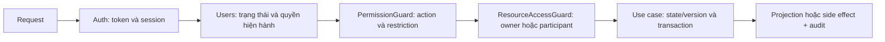

# RBAC và ownership SH-002 Implementation Plan

> **For agentic workers:** Use `superpowers:executing-plans` khi triển khai theo từng task. Checklist theo tiến độ tại [validation.md](validation.md). Không commit/push nếu chưa được người dùng yêu cầu.

**Goal:** Hoàn thành SH-002: backend từ chối request sai permission và owner/participant, có contract dùng chung cho các module nghiệp vụ.

**Architecture:** NestJS modular monolith; users sở hữu role/permission và authorization reader, auth xác minh identity/session. Guard dùng metadata action và đọc quyền hiện hành; module sở hữu resource cung cấp resolver và kiểm tra lại nghiệp vụ trong use case. Guest không lưu DB, ADMIN không có bypass tổng quát.

**Tech Stack:** NestJS 11, TypeScript 6.0.3, PostgreSQL/Prisma 7.8.0; `@nestjs/common`/`@nestjs/core` hiện có; `node:test` theo foundation. Không cần thêm policy engine cho bản đầu.

**Spec:** [spec.md](spec.md). **Date:** 2026-10-04. **Status:** Đang triển khai; lõi guards đã có, database/auth integration còn Pending. Git checkout hiện có `feat/RBAC-design`; chưa tạo/đổi branch.

## Global Constraints

- Backend tại `services/api`; spec tại `services/api/specs`, tooling/Git tại root.
- Constitution v1.2.0; role/permission và membership có PostgreSQL làm authoritative store.
- Không thay JWT access + rotated/revocable refresh và Argon2id của foundation.
- BR-39: permission theo action, không đồng nhất Staff/Admin. BR-40: thao tác nhạy cảm có reason + audit.
- BR-29/36: chat/LiveKit kiểm tra participant; public projection không lộ private data.
- Giữ envelope HTTP hiện có `error.statusCode/message`; không sửa contract lỗi toàn hệ thống trong SH-002.
- Mục 18.34: hạn chế 30–39 chặn tạo Request/Proposal 24 giờ, vẫn cho xem lịch/học buổi đã chốt.
- Grant chưa có artifact chi tiết ở OP-06 và case access còn mở ở OP-04 không trở thành seed production.

## Review Focus

1. Thu hồi permission/khóa account sau khi token được cấp: request kế tiếp bị chặn (Task 2/5).
2. ADMIN hoặc Staff dùng endpoint participant để đọc chat/lấy LiveKit token: không bypass scope (Task 4/5).
3. Parent ID đúng nhưng child ID thuộc object khác; list/count/page 2 vượt scope: không lộ dữ liệu (Task 4/5).
4. Route thiếu metadata, method metadata làm yếu controller policy, request body giả actor: fail closed (Task 3/5).
5. Account chỉ bị hạn chế action hoặc seed chạy lại sau revoke: không khóa sai hoạt động tiếp tục, không phục hồi grant (Task 1/2/5).

## Hiện trạng đã xác minh

| Source hiện có                             | Kết luận từ source                                                                                  |
| ------------------------------------------ | --------------------------------------------------------------------------------------------------- |
| `src/app.module.ts`                        | Config, DB, Redis, queue, throttler và exception filter; chưa có auth/users/authorization providers |
| `src/health.controller.ts`                 | Chỉ health/readiness; chưa có business endpoint để gắn RBAC                                         |
| `prisma/schema.prisma`                     | Chỉ `SystemConfiguration`; chưa có User, Role, Permission, UserRole, RolePermission                 |
| `src/shared/http/http-exception.filter.ts` | Lỗi trả `error.statusCode/message`; 5xx được che thông tin                                          |
| `test/foundation.test.mjs`, `package.json` | `node:test` đọc `dist`; có lint/typecheck/build và `test:foundation`, chưa có script RBAC           |

SH-001 được ghi “Hoàn thành” trong sheet và nền tảng hiện diện trong source.
SH-010/012/003 chưa được triển khai trong checkout này. Vì vậy không thể coi
auth, User model hoặc audit là dependency đã sẵn sàng.

## Lựa chọn thiết kế

| Cách làm                                                  | Đánh giá                                                                                  |
| --------------------------------------------------------- | ----------------------------------------------------------------------------------------- |
| Permission theo action + guard NestJS + resource resolver | Đề xuất: khớp BR-39, tái sử dụng framework hiện có, ranh giới module rõ                   |
| Chỉ `RolesGuard` USER/STAFF/ADMIN                         | Không đủ: không phân biệt approve/revoke/adjust, không chứng minh quyền trên object       |
| CASL/OPA hoặc policy engine riêng                         | Chưa cần cho ba role; thêm dependency và cơ chế policy trước khi có nhu cầu được xác nhận |

Guard toàn cục qua DI và metadata là cơ chế framework hỗ trợ;
xem [NestJS Guards](https://docs.nestjs.com/guards). Phân quyền trên từng object
và negative tests theo ID là biện pháp phòng BOLA;
xem [OWASP API1:2023](https://api-security.owasp.org/editions/2023/en/0xa1-broken-object-level-authorization/).
Các defaults chi tiết dưới đây là đề xuất của dự án, cần review theo spec.

### Luồng request



- Route khai báo rõ `@Public()`, `@Authenticated()` hoặc `@RequirePermissions(...)`.
  Public chỉ dùng cho endpoint được chọn rõ như health và luồng auth Guest.
  Không mặc định biến profile “public” thành anonymous route.
  `@Authenticated()` không thay permission cho endpoint nhạy cảm hoặc thay đổi dữ liệu.
- Auth xác minh JWT/session, gắn identity đáng tin cậy. PermissionGuard đọc actor
  một lần/request từ users, kiểm tra ACTIVE và blocked action rồi kiểm tra quyền.
- Các yêu cầu controller và method được hợp theo AND; không có permission wildcard.
  `@Public()` mâu thuẫn policy protected/resource là lỗi cấu hình, không bỏ qua guard.
- ResourceAccessGuard chạy khi có metadata resource. Resolver được DI từ module
  sở hữu resource, không phải registry tự suy luận tên bảng hoặc graph membership.
  Khai báo resource policy đồng thời ở controller và method bị từ chối để
  method không thể thay thế ownership check của controller.
- Route list không có resource ID phải query scope tại module; guard không lọc
  một mảng kết quả đã tải toàn bộ. Counts/export/download áp dụng cùng điều kiện.
- Module kiểm tra state/version và quyền trên dữ liệu đang mutation trong transaction.
  Mutation nhạy cảm kiểm tra lại quyền hiện hành khi bắt đầu transaction; guard
  ngoài transaction không bảo đảm chống race. Không giữ DB transaction trong provider call.
- Khi auth/users chưa tồn tại, dùng fixture provider chỉ trong test. Chỉ đăng ký
  pipeline toàn cục production sau khi SH-012 và RBAC-05 sẵn sàng.

### Mô hình dữ liệu đề xuất

Giữ dữ liệu trong module `users`, không tạo một hệ thống User/RBAC song song.

| Model            | Fields / constraints đề xuất                                                                         |
| ---------------- | ---------------------------------------------------------------------------------------------------- |
| `Role`           | UUID `id`, unique `code` USER/STAFF/ADMIN, `description`; không có GUEST                             |
| `Permission`     | UUID `id`, unique `code`, `description`; action catalog được version trong source                    |
| `UserRole`       | Composite PK `userId/roleId`, FK đến User/Role, `assignedAt`, nullable `assignedByUserId` cho SYSTEM |
| `RolePermission` | Composite PK `roleId/permissionId`, FK đến Role/Permission                                           |

User là model chung do Huy/SH-010 phối hợp chốt; schema RBAC không định nghĩa
User tối giản thứ hai. Tên cột/map theo chuẩn schema chung lúc RBAC-05 được chốt.
Permission hiệu lực là union RolePermission của UserRole được gán rõ. Không có
UserPermission override, role hierarchy hoặc Redis permission cache trong bản đầu.
Nếu OP-06 yêu cầu phân biệt quyền từng Staff, phải sửa data model trước migration.

Seed catalog idempotent chỉ bảo đảm role/permission tồn tại. Grant ban đầu là
migration/seed riêng đã được review, chạy một lần; rerun catalog không upsert lại
RolePermission bị revoke. Không tự tạo admin account, mật khẩu hoặc blanket grants.

### Contracts đề xuất

Paths trong phần này và các task tính từ `services/api`. Đây là contract đích;
những file chưa có và khác biệt với implementation hiện tại được ghi tại
[validation.md](validation.md).

```ts
type RoleCode = "USER" | "STAFF" | "ADMIN";
type PermissionCode = (typeof PERMISSION_CATALOG)[number]["code"];
type AccountStatus =
  "PENDING_VERIFICATION" | "ACTIVE" | "SUSPENDED" | "LOCKED" | "DEACTIVATED";

// Contract cùng Huy SH-012; không lấy trực tiếp từ body/query/header tự khai.
type AuthenticatedIdentity = { userId: string; sessionId: string };

type Actor = {
  userId: string;
  accountStatus: AccountStatus;
  roles: readonly RoleCode[];
  permissions: ReadonlySet<PermissionCode>;
  blockedPermissions: ReadonlySet<PermissionCode>;
};

// Users sở hữu đọc trạng thái/quyền và tính restriction còn hiệu lực ở `now`.
interface AuthorizationReader {
  loadActor(
    userId: string,
    now: Date,
    tx?: Prisma.TransactionClient,
  ): Promise<Actor | null>;
}

interface ResourceAccessResolver {
  check(input: {
    actor: Actor;
    resourceId: string;
    operation: PermissionCode;
  }): Promise<"allow" | "deny" | "not_found">;
}
```

- `authorization.types.ts` định nghĩa types dùng chung; catalog định nghĩa codes
  đang được triển khai, không đưa toàn bộ permission định hướng vào production.
- `AuthorizationReader` tại application contract của users, có injection token
  `AUTHORIZATION_READER`. Adapter Prisma nằm trong users; guard không query User tables.
- `Prisma.TransactionClient` là type từ generated client hiện có; `tx` cho phép
  consumer kiểm tra lại quyền qua users contract trong cùng PostgreSQL transaction,
  không đọc trực tiếp repository của users. HTTP guard không truyền `tx`.
- `AccessControlService.loadActor(identity, now, tx?): Promise<Actor>` xử lý actor không
  tồn tại thành 401; lỗi đọc storage thành 503. Service không xác minh JWT thay auth.
- `AccessControlService.assertPermissions(actor, required): void` kiểm tra ACTIVE,
  blockedPermissions và đủ tất cả permission; không đủ trả 403.
- `ResourceAccessGuard` đọc `@CheckResource({ resolver, idParam, operation })`.
  `resolver` là DI token được module consumer đăng ký; gọi contract `check`.
  `deny/not_found` cho private resource cùng trả 404 theo RBAC-06; lỗi storage 503.
  ID không đúng dạng theo resource contract trả 400, kể cả guard chạy trước pipes.
- Token sessionId đang là đề xuất; phải align auth contract trước integration.
  Logout/status/recovery cho account bị khóa thuộc RBAC-03; không dùng flag do client
  gửi để vượt account policy. Public OTP/reset vẫn có validation/abuse control riêng.

Resolver nghiệp vụ không đồng nghĩa dữ liệu được trả nguyên bản: projection private,
signed file URL, state và join window vẫn thuộc consumer. Các job hệ thống dùng
contract nội bộ theo module, không giả một User ADMIN để bypass guard.

## Phối hợp theo Google Sheet

| Task                  | Owner trong sheet | Contract / phụ thuộc SH-002                                                                       |
| --------------------- | ----------------- | ------------------------------------------------------------------------------------------------- |
| SH-010/012/014/016    | Huy               | User/identity, session revocation, role USER khi register/OAuth, account restrictions             |
| SH-003                | Long              | Reason/audit dùng bởi các use case nhạy cảm; không ghi audit “thành công” từ guard trước mutation |
| SH-100, OP-06         | Huy               | Role/permission management, Staff matrix, policy cấp ADMIN                                        |
| SH-023/024/025/032    | Long              | Owner resolver, verification/moderation permissions; consumer đầu tiên                            |
| SH-021/004            | Long              | Public/private projection; quyền evidence/file, tách storage implementation                       |
| SH-043/044/045, OP-04 | Long              | Membership PostgreSQL, child/parent checks, chat/files, case access                               |
| SH-073                | Huy               | Participant Session trước cấp LiveKit token, không bypass theo ADMIN                              |
| SH-091/101/102/104    | Long              | Report/dispute và admin action theo permission cụ thể                                             |
| SH-120/124            | Long              | Regression permission/privacy và reason/audit khi consumer sẵn sàng                               |

Backlog chỉ ghi SH-001 là dependency trực tiếp SH-002. SH-010/012 là dependency
kỹ thuật phát hiện từ source cho migration/integration production, không phải
thay đổi phân công hoặc status trong sheet. SH-100 dùng SH-002; không đợi admin
portal rồi mới làm permission guard để tránh vòng phụ thuộc.

## Constitution Check

Review ngày 2026-10-04, constitution v1.2.0. Pass ở đây là phù hợp thiết kế;
không phải bằng chứng implementation/runtime.

| Principle                              | Status / evidence                                                                                                              |
| -------------------------------------- | ------------------------------------------------------------------------------------------------------------------------------ |
| 1 Scope, modular monolith              | Pass cho draft: API và docs; không frontend/microservice/layer rỗng                                                            |
| 2 Authoritative stores                 | Pass cho design: users/permission/membership PostgreSQL; không đọc Mongo message làm nguồn membership                          |
| 3 Atomic critical workflows            | Pending implementation: quyền/state + mutation nhạy cảm/audit dùng transaction ở consumer; SH-002 không viết ledger            |
| 4 Authentication/authorization/privacy | Pass cho design; Pending JWT integration, OP-06/04 và guard/consumer runtime tests                                             |
| 5 Validation/API/UTC                   | Pass cho design: envelope hiện có, validation ID trước resolver, timestamp UTC; OpenAPI security metadata Pending integration  |
| 6 Verification                         | Pending Tasks 1–5 và integration real PostgreSQL; không tuyên bố bảo vệ hệ thống từ fixture                                    |
| 7 Data ownership/contracts             | Pass cho design: users reader, module-owned resolvers, không cross-module write; RBAC-05 Pending thống nhất                    |
| 8 Reliable delivery                    | Not applicable cho SH-002: không thêm jobs/webhooks/outbox. Audit/mutation phải atomic ở consumer; delivery thuộc feature khác |
| Git workflow                           | Pass cho lần này: chỉ docs, không stage/commit/push; khi tạo branch dùng naming theo AGENTS.md                                 |

### Complexity Tracking

Không đề xuất ngoại lệ constitution. Nếu cách kiểm tra quyền trong transaction
cần khác nguyên tắc đã chốt, ghi impact/mitigation/owner/expiry và xin phê duyệt
ngoại lệ trước implementation. Dependency auth chưa có không cho phép thêm auth giả production.

## Kế hoạch triển khai

Thứ tự: review Task 1 → schema/reader Task 2 → guard Task 3 → resolver Task 4 →
integration và handoff Task 5. Types/policy thuần có thể thiết kế trước SH-012;
production wiring và kết luận DoD đầy đủ phải đợi dependency thực.

### Task 1 Chốt catalog và access policy

**Create:** `src/shared/authorization/authorization.types.ts`,
`src/shared/authorization/permission.catalog.ts`,
`src/shared/authentication/authenticated-identity.ts`,
`test/authorization-policy.test.mjs`.
**Modify:** `package.json` thêm script `test:rbac` khi có test thật.
**Interfaces:** produces `RoleCode`, `PermissionCode`, `AccountStatus`, `Actor`,
`AuthenticatedIdentity`, `PERMISSION_CATALOG` cho Tasks 2–5.

- [ ] Review RBAC-01..06 với owner; ghi rõ grant nào được phép triển khai và quyền nào tiếp tục blocked.
- [x] Viết test catalog: unique permission codes; không GUEST/wildcard; approve/revoke là action riêng. Dùng chung `test/authorization.test.mjs`.
- [x] Khai báo types/catalog cho action đã chọn; read/approve/reject/revoke là codes riêng.
- [x] Thêm `test:rbac` chạy unit và HTTP harness qua `node --test`.
- [x] Build và chạy focused tests thành công. Chưa cấp grants production cho quyền đang chờ OP-06.

### Task 2 Users authorization reader và quyền hiện hành

**Create:** `src/modules/users/application/ports/authorization-reader.port.ts`,
`src/modules/users/infrastructure/persistence/prisma-authorization.reader.ts`,
`src/shared/authorization/access-control.service.ts`,
`test/authorization-persistence.test.mjs`.
**Modify:** `prisma/schema.prisma`, `src/modules/users/users.module.ts` do SH-010
cung cấp; thêm migration RBAC mới dưới `prisma/migrations/` với timestamp thực
được Prisma sinh và script `test:rbac:integration`.
**Interfaces:** consumes types Task 1 và User model RBAC-05;
produces `AUTHORIZATION_READER`, `AuthorizationReader.loadActor(userId, now, tx?)`,
`AccessControlService.loadActor(identity, now, tx?)` và `assertPermissions(actor, required)`.

- [ ] Chốt User FK, enum status, restriction source và identity với Huy; không tạo migration khi User contract chưa tồn tại.
- [x] Viết policy tests: thiếu permission trong AND → 403; ADMIN thiếu permission → 403; status không ACTIVE bị chặn; action restriction giữ các quyền khác. JWT thật vẫn Pending.
- [ ] Viết failing PostgreSQL tests: unique/FK/composite PK, union nhiều role, revoke grant giữa hai lần đọc, account chuyển LOCKED và seed catalog không regrant.
- [ ] Thêm Role/Permission/UserRole/RolePermission và migration theo schema chung. Reader query quyền hiện hành, không cache qua request; tính restriction ở `now` từ users policy.
- [ ] Implement service signatures ở trên; actor không tồn tại → 401, storage error → 503, non-ACTIVE/blocked/thiếu permission → 403.
- [ ] Test restriction 30–39: create Request/Proposal bị từ chối trong 24 giờ; read schedule/participate Session được phép khi ACTIVE và đủ permission; hết hạn thì create được lại.
- [ ] Chạy `pnpm --filter api db:validate`, build và policy tests. Trên DB test riêng, chạy `pnpm --filter api test:rbac:integration`; ghi rõ nếu runtime chưa sẵn sàng.

Integration script dự kiến: `node --test test/authorization-persistence.test.mjs`.
DB test dùng config ignored riêng; không truncate/reset dữ liệu development hoặc production.
Grant ban đầu đã duyệt và rerun catalog phải được kiểm chứng riêng, không dùng
`upsert RolePermission` vô điều kiện như một cách “đồng bộ seed”.

### Task 3 Permission guard và metadata an toàn

**Create:** `src/shared/authorization/access.decorators.ts`,
`src/shared/authorization/permission.guard.ts`,
`src/shared/authorization/authorization.module.ts`,
`test/authorization-guards.test.mjs`.
**Modify tại Task 5:** `src/app.module.ts`, `src/health.controller.ts`.
**Interfaces:** consumes Task 2 service và identity của auth;
produces `Public()`, `Authenticated()`, `RequirePermissions(...codes)`,
`PermissionGuard.canActivate(context): Promise<boolean>`.

- [x] Test Nest ExecutionContext/Reflector thật: Guest/protected → 401; thiếu permission → 403; route thiếu policy bị deny.
- [x] Test controller + method metadata theo AND; `Public()` mâu thuẫn protected policy báo lỗi.
- [x] Implement decorators và PermissionGuard; nhận identity từ auth provider contract, không đọc role tự khai từ client.
- [x] Actor được load theo request; không có cache quyền liên request.
- [x] Build và unit/HTTP fixture tests thành công. `AuthorizationModule`/production wiring vẫn Pending.

ThrottlerGuard vẫn hoạt động. Module cung cấp guard qua DI; thứ tự auth → permission
→ resource phải được test ở HTTP harness, không dựa vào giả định thứ tự import module.
Không đăng ký global guard production khi auth provider thực còn thiếu.

### Task 4 ResourceAccessGuard và consumer contracts

**Create:** `src/shared/authorization/resource-access-resolver.port.ts`,
`src/shared/authorization/check-resource.decorator.ts`,
`src/shared/authorization/resource-access.guard.ts`, `test/resource-access.test.mjs`.
**Interfaces:** consumes Actor/PermissionCode;
produces `ResourceAccessResolver.check(input)`,
`CheckResource({ resolver, idParam, operation })`,
`ResourceAccessGuard.canActivate(context): Promise<boolean>`.

- [x] Test owner/outsider/ADMIN outsider với resolver fixture. Participant, missing resource và parent/child cần consumer thật.
- [x] Implement ResourceAccessGuard qua DI token resolver; validate ID trước gọi resolver.
- [x] `deny/not_found` private resource → cùng 404; permission thiếu vẫn 403 ở guard trước; resolver error → 503.
- [x] Test CheckResource yêu cầu action đã khai báo; policy thiếu bị từ chối.
- [ ] Test batch có một item ngoài scope: không trả dữ liệu hoặc mutation trái phép; module mutation phải kiểm tra toàn batch trước side effect và rollback toàn bộ khi thất bại.
- [ ] Ghi contract consumer SH-023/025/032/043/073: owner/membership query do module sở hữu; nested ID, list/count/export scope và mutation recheck trong transaction.
- [x] Build và unit/HTTP fixture tests thành công; resolver thật của module nghiệp vụ vẫn Pending.

Consumer đầu tiên dự kiến SharingSkill owner và SkillVerification/LearningRequest
moderation. Conversation/Session chưa có schema trong checkout; không tạo toàn bộ
domain chỉ để SH-002 có ví dụ. Các fixture phải cover ownership/member logic nhưng
không được báo là đã kiểm chứng PostgreSQL membership hoặc chat/LiveKit production.

### Task 5 HTTP integration, regression và handoff

**Create:** `test/authorization-http.test.mjs`, `specs/002-rbac-ownership/validation.md`.
**Modify:** `package.json` dùng script `test:rbac` hiện có cho cả unit và HTTP harness; `src/app.module.ts`,
`src/health.controller.ts`, `src/configs/swagger.config.ts` khi wiring production;
`README.md` ghi contracts/trạng thái cuối cùng.
**Dependencies:** auth guard/module của Huy SH-012, users reader Task 2,
guards Tasks 3/4; SH-003 khi consumer nhạy cảm thực sự được triển khai.
**Interfaces:** HTTP error giữ `{ error: { statusCode, message } }`;
exports AuthorizationModule cho consumers, không export persistence repository.

- [x] Tạo HTTP harness dùng Nest thật, identity fixture chỉ trong test module và port ngẫu nhiên.
- [x] Test fixture identity → permission → resource cho 401/403/404/200 theo error envelope; JWT và health public production còn Pending.
- [ ] Test quyền đổi giữa requests, blocked account, ADMIN outsider, malformed ID, missing metadata, controller/method conflict và payload role giả.
- [ ] Test consumer list/count/page 2/nested IDs bằng resolver/query thật khi consumer tồn tại; nếu chưa có thì ghi Pending, không thay bằng fixture rồi đánh dấu đạt.
- [ ] Với SH-012/RBAC-05 sẵn sàng, gắn guard pipeline vào AppModule và khai báo health public; thêm Bearer/401/403/404 vào Swagger cho endpoints bảo vệ thực.
- [ ] Test JWT thật ở production integration: signature/expiry/session revoke và role revoke khi JWT còn hiệu lực. Đây là điểm handoff với Huy, khác fixture authorization tests.
- [ ] Với SH-003 và consumer nhạy cảm sẵn sàng, regression reason/audit: thiếu reason bị chặn; audit failure rollback mutation. SH-124 tiếp tục mở rộng tới admin/credit/dispute.
- [x] Chạy lint, typecheck, build, foundation tests và RBAC unit/HTTP fixture tests; ghi kết quả/Pending trong validation.md. Constitution và DoD phải recheck sau integration.

Commands từ root sau khi scripts/tests dự kiến đã được tạo:

```powershell
pnpm --filter api lint
pnpm --filter api check-types
pnpm --filter api build
pnpm --filter api test:foundation
pnpm --filter api test:rbac
pnpm --filter api test:rbac:integration
```

`test:rbac` build mã nguồn rồi chạy unit và HTTP fixture tests, tránh dùng
`dist` cũ; không cần script HTTP riêng.
Fixture harness không thay thế real JWT/database integration; kiểm thử private
projection/upload và LiveKit của SH-120 chạy khi feature tương ứng có source.

## Definition of Done và trạng thái lần lập kế hoạch

DoD của SH-002 trong sheet: “Backend từ chối đúng request sai role/permission/ownership.”
Framework phải có negative tests và được gắn với auth/users thực. Consumer chưa
triển khai vẫn có acceptance contract/Pending integration, không tuyên bố toàn bộ
business API đã được bảo vệ. SH-120/124 không phải lý do trì hoãn negative tests SH-002.

Lần triển khai này đã thêm catalog/policy/guards và fixture tests. Database
reader, migration, JWT production integration, consumer-owned resolvers và audit
vẫn Pending. Bước tiếp theo là nhận artifact grant OP-06/RBAC-01 đã chốt và chốt RBAC-05 với Huy, rồi nối users/auth thật
và kiểm chứng PostgreSQL, các endpoint nghiệp vụ theo [validation.md](validation.md).
