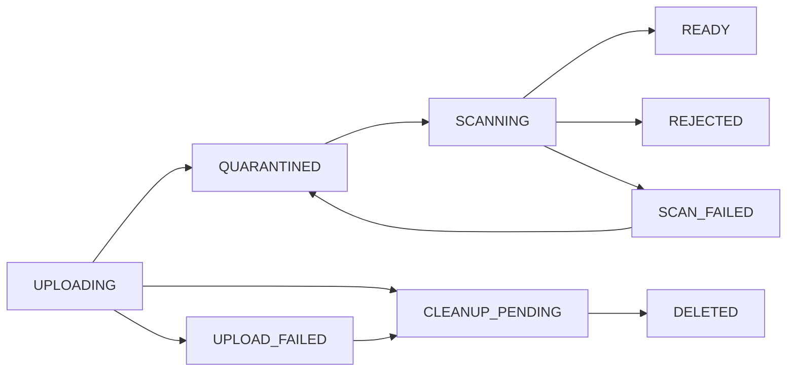

# Feature Specification: Private file storage và upload validation SH-004

**Date:** 2026-10-04. **Status:** Implemented 2026-10-05; lifecycle đã kiểm chứng trên PostgreSQL, S3/ClamAV/BullMQ còn Pending — xem [validation.md](validation.md).
**Owner:** LogKoNger (Long trong backlog). **Workspace:** `services/api`.

## Mục tiêu và nguồn yêu cầu

File evidence/chat/report giữ private; file sai extension/MIME/size hoặc chưa
được scan không được mở, download chỉ cấp sau kiểm tra quyền trên resource.
Backlog dòng 5: SH-004, Long, dependency SH-001; NFR-FILE-01/PRV-01, BR-04/29.
DoD: private, không public URL vô thời hạn, file sai rule bị từ chối.

Nguồn: [Backlog](https://docs.google.com/spreadsheets/d/1jdgrnCNeQLK1g339kY0WUYy6o7lgx6hG9j0tu1fb1Xw/edit?gid=733891926#gid=733891926),
[SRS v1.4](../../../../docs/SRS_SkillHub_V1.4_BoSungQuyDinhNghiepVu_VI.docx)
mục 9.1, 12, 18.1/9/12/23, BR-04/29, CHAT-001/002 và
[constitution](../../.specify/memory/constitution.md).
Tài liệu/sheet cung cấp yêu cầu; lifecycle/storage paths/TTL dưới đây là đề xuất.
Evidence cap 10 MB trong logical model v1.3 không là giá trị đã chốt của v1.4.

## Hiện trạng và phương án

Repo chưa có upload route, S3 adapter, file table, scanner hay domain attachments.
RBAC có contracts/fixture tests, chưa có auth/participant readers production.
Chọn upload backend streaming vào private S3-compatible storage và async scan
qua durable outbox/BullMQ. Không cấp presigned PUT ở bản đầu; tránh client thay
nội dung sau khi file được scan. Signed GET ngắn hạn sau permission check.

Alternative synchronous scan làm request phụ thuộc scanner chậm; direct-to-S3
upload cần thêm immutable-version/finalize/overwrite controls. Hai cách này chưa
cần để hoàn tất bản foundation. Không chọn cloud bucket/provider thương mại cụ thể.
Đề xuất scanner baseline là ClamAV clamd INSTREAM ở trusted private deployment.

## Scope và ownership

Infrastructure storage sở hữu **technical** StoredFile lifecycle, object key,
size/hash/MIME/scan state. Module verifications/conversations/reports sở hữu
binding `fileId → verification/message/case`, owner/participant/case permissions
và file count. Không gom membership graph vào storage service.

Foundation cung cấp internal services/adapters/tests; upload/download HTTP nằm
ở consumer routes tương ứng. Không tạo generic public `/files/:id` hoặc endpoint
nhận arbitrary resourceType/ownerId/resolver từ client khi consumers chưa có.

## Requirements

- **R-01:** Storage private, anonymous read bị từ chối; server sinh UUID/object
  key. Filename chỉ là display metadata đã sanitize, không dùng làm path.
  Không public ACL, permanent object URL hoặc return storage credential/key cho client.
- **R-02:** Module xác thực actor và scope trước nhận upload; server chọn purpose
  và registered policy. Client không tự chọn cap/allowlist hoặc ownerId.
  Evidence 1–5 files/submission, report tối đa 5 files do module kiểm tra.
- **R-03:** Chat cap 15 MB/file theo 18.12/CHAT-002; dùng decimal 15.000.000 bytes
  làm convention kỹ thuật rõ ràng, `size <= cap`. Evidence/report cap lấy key
  `storage.evidenceMaxBytes` đã được chốt; missing key không cho upload.
- **R-04:** Allowlist evidence/report: PDF, DOC, DOCX, JPG/JPEG, PNG, WEBP.
  Chat thêm XLS/XLSX, PPT/PPTX, TXT theo 18.12. Validate normalized final extension,
  detected magic/container format, claimed MIME và actual byte count. ZIP/OOXML,
  OLE Office phải phân biệt đúng loại, không tin generic ZIP/OLE header là DOCX/DOC.
- **R-05:** Reject zero-byte, MIME/extension mismatch, executable/HTML/SVG/archives
  ngoài allowlist, encrypted/uninspectable document. Giới hạn parser đọc/giải nén
  để tránh archive bomb; header Content-Length không thay actual stream limit.
- **R-06:** Upload private object rồi finalize metadata+scan outbox trong DB tx.
  S3/DB không atomic: UPLOADING/failed rows được reconcile; crash không làm file
  thành READY hoặc signed. Không provider call trong PostgreSQL transaction.
- **R-07:** Chỉ READY sau scanner verdict CLEAN cho đúng immutable object hash/
  generation. INFECTED/UNKNOWN/timeout/unavailable không là CLEAN. Không no-op
  scanner mặc định. Duplicate/stale workers không ghi đè verdict đời mới.
- **R-08:** Download qua server-selected module access policy: current permission,
  owner/participant/case scope và parent-child binding. ADMIN không bypass chat.
  Unauthorized/missing file cùng 404; authorized nhưng chưa READY không nhận URL.
- **R-09:** Signed GET TTL lấy SH-006 default 120 s, max 300 s; filename-safe
  attachment disposition, actual MIME và anti-inline controls. URL là bearer:
  quyền bị revoke ngăn cấp URL mới, URL đã cấp có thể còn dùng tới expiry. Không
  hứa immediate revoke; flow đòi revoke tức thời cần authenticated proxy sau này.
- **R-10:** Scan enqueue durable; delivery/worker bounded retry và failure state
  retained. Requeue có controlled service, giữ generation/verdict history để
  điều tra. Scanner outage không làm mất domain/file metadata hoặc mở quyền.
- **R-11:** Không log body bytes, signed URL/query signatures hoặc credentials.
  Provider errors trả 503 an toàn; actual-size limit 413, unsupported format 415.
  Business state/evidence PENDING không tự thành VERIFIED vì file READY.
- **R-12:** Cleanup chỉ upload incomplete/failed sau operational grace đã cấu
  hình, đề xuất 24 h. Không auto xóa READY/bound files khi retention OP-04 chưa
  chốt. Trước delete phải recheck state/generation; orphan object và dangling row
  có recovery path riêng, không giả một distributed rollback.

## Lifecycle và persistence

`StoredFile`: UUID fileId, purpose, uploadedBy UUID snapshot, private objectKey
unique, generation, safe originalName, detectedMime, sizeBytes, SHA-256,
state, scanAttempts/verdict/scannerVersion/scannedAt, scanLeaseToken/leaseUntil,
createdAt/updatedAt UTC. No User FK tạm; domain binding tables bổ sung ở consumers.
Object bytes ghi một lần bằng server key duy nhất; retry không overwrite object
READY. Provider version ID lưu nếu có, nhưng không dựa vào versioning chưa được bật.

Operational proposals: scan timeout 30 s, lease 60 s, max 3 scan attempts;
ZIP metadata parser budget khoảng 1 MiB; legacy OLE `cfb` materialize file đã bị
cap 10/15 MB để kiểm tra stream nội bộ. Tối đa 1.000 container entries và expanded bytes
không vượt min(10×stored size,100 MB). Đây là technical safety bounds, không phải
file-cap từ SRS; scanner/parser limit-hit là UNKNOWN/reject, không clean.

Cleanup claim đổi expired UPLOADING/UPLOAD_FAILED thành CLEANUP_PENDING bằng
state/generation CAS trước provider delete. Finalize chỉ thành công nếu row còn
UPLOADING; CLEANUP_PENDING không được finalize/scan/sign. Delete retry thành công
chuyển DELETED; không có khe recheck→delete cho một file đã finalize hợp lệ.

## Acceptance và gates

1. MIME header PDF nhưng actual executable, ZIP giả DOCX, double extension hoặc
   traversal filename không được lưu thành READY; valid file tại cap pass, cap+1 fail.
2. Scanner down/infected/UNKNOWN: không có signed URL. Fake clean scan adapter chỉ
   trong test module; production enabled storage yêu cầu real scanner adapter.
3. Owner/participant hợp lệ có URL ngắn hạn; outsider/ADMIN outsider/child thuộc
   parent khác không có URL. URL không xuất hiện trong logs/audit/error.
4. Crash sau object put/trước finalize và crash sau DB commit/trước enqueue đều
   recover hoặc giữ private pending; queue duplicate không nhân state changes.
5. Stale scan verdict không mở generation mới; timeout/lease expiry worker retry
   tiếp tục đúng file. Object immutable trong vòng đời scan→download.
6. Anonymous S3 GET bị từ chối; expired signed URL không đọc được; denied file
   không trở thành VERIFIED hoặc attachment visible.

SH-005 context/outbox/queue recovery, SH-006 policy/Clock/env và SH-002/auth/users
scope là dependencies kỹ thuật. SH-024/025/044/090 tích hợp bindings/routes thật;
SH-120 mở rộng privacy regression. Foundation chỉ hoàn tất khi real S3/scanner
và DB/queue recovery evidence có; ownership business chưa có ghi Pending.
