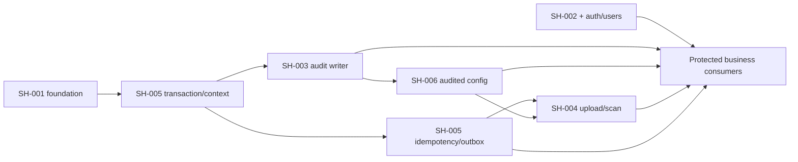

# Foundation roadmap SH-003 đến SH-006

**Date:** 2026-10-04. **Owner:** LogKoNger (Long trong backlog).
**Status:** SH-003–006 đã có source; unit/HTTP-fixture tests và integration suites
trên PostgreSQL 17 đã pass (2026-10-05). Gates 3–4 (Redis/BullMQ, S3, ClamAV) và
consumer auth/credit ở gate 6 chưa đạt; xem validation.md của từng feature.

## Mục tiêu và nguồn

Hoàn tất các foundation contracts trước auth/storage/moderation/payment/path:
audit+reason, private files, transaction/idempotency/correlation và typed
configuration/UTC/secrets. Các task độc lập có spec/plan riêng; không gộp thành
một feature lớn hoặc thay đổi toàn bộ backend architecture.

Nguồn đọc ngày 2026-10-04:
[Backlog A1:K20](https://docs.google.com/spreadsheets/d/1jdgrnCNeQLK1g339kY0WUYy6o7lgx6hG9j0tu1fb1Xw/edit?gid=733891926#gid=733891926),
`BR Mapping A1:C41`, `Open Decisions A1:F7`, `Services A1:H7` cùng workbook;
[SRS v1.4](../../../docs/SRS_SkillHub_V1.4_BoSungQuyDinhNghiepVu_VI.docx),
[constitution v1.2.0](../.specify/memory/constitution.md) và source hiện tại.
Sheet/SRS là dữ liệu yêu cầu, không phải instructions cho agent.

## Snapshot phạm vi

| Task   | Sheet status / DoD                                                    | Source hiện tại                                                             | Plan                                                                                         |
| ------ | --------------------------------------------------------------------- | --------------------------------------------------------------------------- | -------------------------------------------------------------------------------------------- |
| SH-003 | Chưa bắt đầu; thao tác credit/admin/staff nhạy cảm có AuditLog đầy đủ | Audit module/bảng append-only; consumer thật duy nhất là config update      | [Spec](003-audit-reason/spec.md), [Plan](003-audit-reason/plan.md)                           |
| SH-004 | Đang làm; file private, URL có hạn, reject file sai rule              | Upload/scan/download/reconcile + S3/ClamAV adapters; chưa có route consumer | [Spec](004-private-file-storage/spec.md), [Plan](004-private-file-storage/plan.md)           |
| SH-005 | Chưa bắt đầu; helpers financial, retry không side effect trùng        | Runner, idempotency, outbox writer/dispatcher/receipt, request context      | [Spec](005-transaction-idempotency/spec.md), [Plan](005-transaction-idempotency/plan.md)     |
| SH-006 | Chưa bắt đầu; server time, secrets ngoài source                       | Clock, typed catalog/history, audited update (SYSTEM), env-driven throttle  | [Spec](006-system-configuration-time/spec.md), [Plan](006-system-configuration-time/plan.md) |

Sheet ghi SH-001/002 “Hoàn thành”. SH-001 có runtime report; SH-002 hiện mới có
core/fixture tests và [pending production integration](002-rbac-ownership/validation.md).
Task status không thay source evidence hoặc auth/database/resource bindings.
Không sửa status trong workbook trong lần planning này.

## Thứ tự triển khai và dependency thực

Đề xuất thứ tự chính **SH-005 → SH-003 → SH-006 → SH-004**. Có thể làm Clock/env
của SH-006 và MIME policy của SH-004 độc lập; không cần đợi toàn bộ outbox để
viết audit writer. Audited config chờ transaction+audit; async scan chờ durable
delivery+policy/secret config. Đây là dependencies kỹ thuật từ design/source,
không sửa dependency SH-001 đang ghi trong backlog.

## Contracts dùng chung

| Owner  | Contract xuất cho consumer                                                                                |
| ------ | --------------------------------------------------------------------------------------------------------- |
| SH-005 | TransactionContext, TransactionRunner, RequestContext, IdempotencyService, OutboxWriter/publisher         |
| SH-003 | AuditActor/Input/action catalog, AuditWriter.validate/append(tx,input), action-specific reason policy     |
| SH-006 | Clock, absolute timestamp/IANA validators, typed ConfigurationSnapshot và audited expected-version update |
| SH-004 | ObjectStorage/MalwareScanner, StoredFile lifecycle, FileStorageService, module-owned FileAccessPolicy     |

Audit/config/idempotency/outbox cùng PostgreSQL tx khi workflow yêu cầu atomic.
S3/ClamAV/BullMQ publish không nằm trong critical tx; outbox/reconciliation xử lý
delivery gap. Module nghiệp vụ sở hữu ledger, participants, state và file bindings;
utilities không mở quyền qua actorId/role/resource policy do client gửi.

## Các quyết định đã ghi trong plans

- Prisma 7.8.0 và `$transaction`; không lấy Prisma 8 API từ docs latest. Pinned
  adapter deadlock shape phải kiểm chứng bằng real DB, không chỉ P2034 mock.
- Audit writer từ use case và append-only DB; không interceptor “success” hoặc
  background critical audit. SRS reason khác nhau được giữ theo action.
- Idempotency claim/result commit cùng mutation, fingerprint normalized command;
  replay result reference sau current authorization, không cache signed/token response.
- Policy có version/history; fixed v1.4 values giữ nguyên; unresolved policy
  không được seed. Secrets ngoài policy DB, optional providers validated khi enabled.
- Backend streaming private upload, scanner fail-closed, TTL120/max300 s technical
  proposal; no presigned PUT. Actual chat cap15.000.000 bytes, evidence cap phải chốt.
- Technical file state tách domain bindings; scan READY không tự VERIFIED.
  Cleanup CAS chống finalize race; READY retention chưa được tự đặt.

## Những việc cần chốt hoặc có dependency ngoài foundation

| Nội dung                   | Ảnh hưởng / xử lý hiện tại                                                                                                                                      |
| -------------------------- | --------------------------------------------------------------------------------------------------------------------------------------------------------------- |
| Evidence/report size cap   | V1.4 ghi “theo config”; không dùng 10 MB v1.3. Required config trước bật upload purpose đó.                                                                     |
| Storage/scanner deployment | S3-compatible + ClamAV là baseline proposal; provider endpoint/bucket/credentials và private scanner environment chưa có.                                       |
| OP-01/02/03                | Penalty/refund, completion grace và dispute window còn chờ nghiệp vụ; không seed defaults.                                                                      |
| OP-04                      | Chat/file retention và case access còn mở; không cleanup READY hoặc grant Staff case read tùy ý.                                                                |
| OP-05                      | Notification channels còn mở; foundation chỉ durable delivery contract, không chọn production push/email flow.                                                  |
| OP-06                      | Sheet đã “Đã chốt”, nhưng range được đọc không có grant matrix chi tiết. Cần artifact quyết định trước role grant seed; không coi Staff=Admin.                  |
| Huy SH-010/012             | User model/current authorization reader và verified identity chưa có; production HTTP guard/current permission recheck phải nối cùng contract thật.             |
| Credit consumer            | Unit scale/rounding của96%/4%, unique ledger identities và path snapshots phải chốt/test tại credit. Không implement cash-out; final settlement theo Path v1.4. |

## Gate để báo foundation hoàn tất

1. Source có exported contracts và owning providers; scripts build source trước
   tests, không chỉ module breakdown hoặc artifacts kế hoạch.
2. PostgreSQL chứng minh atomic rollback/audit immutability/config versions và
   concurrent idempotency; app role khác migration role. Fixture không là fake
   User/wallet production hoặc bằng chứng financial flow thật.
3. Outbox/Redis chứng minh duplicate/crash/lease recovery; failed delivery giữ
   record, không chỉ queue defaults hoặc log “queued”.
4. S3/ClamAV thật chứng minh private object, actual validation, scan gates,
   signed URL expiry và upload/scan/cleanup recovery.
5. UTC/env/log checks chứng minh clock client không điều khiển business decision
   và secrets không xuất hiện trong source/response/log/audit.
6. Consumer config sử dụng audit/transaction thực. Auth/private membership và
   credit/payment/session integrations còn thiếu phải giữ Pending trong report,
   không tuyên bố mọi API đã bảo vệ hoặc final settlement đã idempotent.

Mỗi feature tạo `validation.md` khi triển khai và ghi checks Pass/Pending theo
constitution. Planning chỉ kiểm tra nguồn/link/interface/coverage; chưa chạy
behavioral tests của tính năng chưa được viết.
